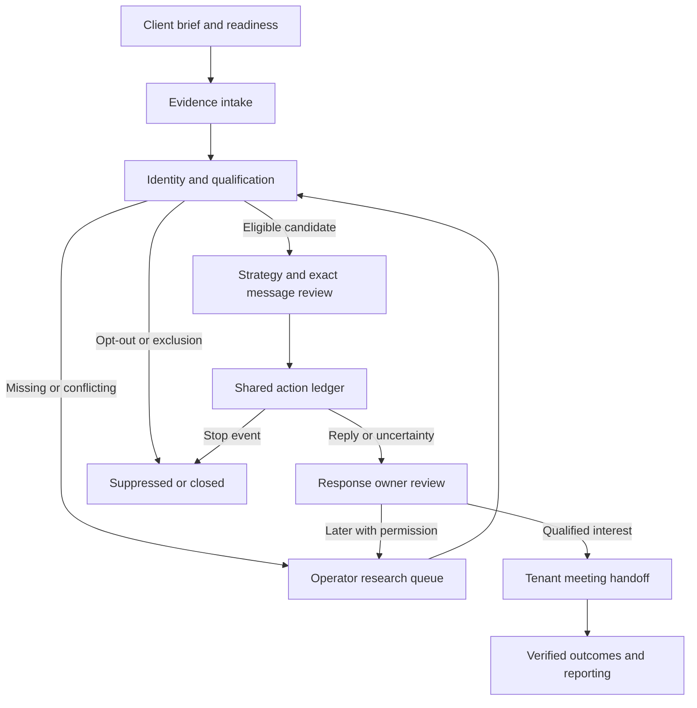

# Ripe Piper: evidence-led lead generation and outreach specification

Version 2 · 26 October 2026 · Status: preparation pilot IMPLEMENTED and locally tested; lifecycle execution remains partially specified and incomplete.

This is the detailed contract supporting the existing [delivery backlog](DELIVERY.md), not a second backlog or a new application. Delivery status, ownership and priorities remain in DELIVERY. The initial investigation authorised specification and isolated synthetic testing. On 26 October the owner authorised starting product development using the Elephant-Goldfish technique. The bounded development increment below remains local and reversible. No account connection, live outreach, service spending, production mutation or deployment is authorised by this document.

## 1. Product concept and business boundary

**Ripe Piper is a managed lead-generation business that helps each client turn relevant, evidenced opportunities into useful conversations, qualified meetings and traceable commercial outcomes.** Its operators configure the service after discovery. Clients do not have to build automations or operate a self-service SaaS product.

Ripe Piper owns the platform and service delivery. Anvukta is one configurable sample client. Its offer, construction segment, geography, copy and credentials must never become application defaults. A second client must use the same code with its own configuration and evidence.

Four actors have distinct responsibilities:

| Actor | Authority and accountability |
|---|---|
| Ripe Piper operator | Owns the client engagement and exceptions, verifies evidence, prepares campaigns and operates approved actions. Admin access is currently broad; scoped operator assignment is a future access improvement. |
| Client organisation | Owns its offer, authorised sender identity, permitted sources, audience constraints and commercial decisions. Its named business approver accepts scope and claims. |
| Client user | Owner or viewer with access only to permitted information in their organisation. Client ownership does not grant platform administration or authority to use another client's provider. |
| Prospect | External person whose identity, preferences and context are respected. A target account, a contact and an authenticated client user are different concepts. |

Keep Ripe Piper's own customer acquisition separate from client delivery. Existing public consultation routes use `tenant_id=null`; preserve that historical design. Client campaign operations must require a non-null tenant and exact tenant credentials. Ripe Piper dogfooding is an ordinary configured tenant, not a fallback to the public pipeline.

## 2. Evidence-backed baseline

Audited application source: `a67888e007e3559d7244c6727e540701d99fdd2e`, tree `c57a080d9b118a3d7fefb055bed1850326f7ea24`. [PR #9](https://github.com/DipurajThapa/ripepiper/pull/9) was rechecked open and unmerged. Its [CI 40130444237](https://github.com/DipurajThapa/ripepiper/actions/runs/40130444237) passed 977 backend tests, 193 Node checks and four browser programs; staging was skipped. These are source/test receipts, not operational acceptance.

Table terminology: **verified locally** means functioning code with bounded synthetic evidence; **partial** means a useful component lacks required integration; **missing** means the required behaviour was not found; **unverified** means evidence is insufficient. A TypeScript interface or visible button alone is not implementation. Paths below use `P = platform/ripe-piper-platform`.

| Journey capability | Actual behaviour and source | Assessment / necessary improvement |
|---|---|---|
| Client creation and brief | `P/src/foundation/tenants.ts` and `prospecting-routes.ts:saveBrief`; versioned `business_briefs` | Verified locally. Website/interview extraction into an approved brief remains manual, not autonomous business understanding. |
| Client readiness | `foundation/revive-setup.ts`; migration `20261024161910_revive_client_setup.sql` | Verified Revive setup, partial shared readiness. Sender/domain/calendar entries are supplied facts, not proof of provider access. |
| Imports and identity | `prospecting-routes.ts:importReviewLeads`; `0001_core.sql:leads_email_per_tenant`; provenance migration | Verified bounded import and per-tenant normalised-email dedupe. Company is text; organisation resolution, employment verification and cross-email person merging are missing. |
| Signal discovery | `foundation/signal-sources.ts` | Verified approved JSON-feed preview/digest/review/import. Feed already supplies email. It is not autonomous web discovery or contact finding. Polling, source health and additional adapters are missing. |
| Qualification | `foundation/prospecting.ts:assessProspect`, `products.ts:reviewProducts` | Verified four supported dimensions, unknown/conflict/excluded and freshness. Literal evidence matching is not semantic verification. No conversion probability; readiness and engagement remain unknown. |
| Strategy and drafting | `foundation/campaigns.ts`, `revive-strategy.ts`, `revive-draft.ts` | Revive has reviewed strategy and deterministic proposals. Signal has manual drafts; structured strategy is Revive-only. Cohort drafts deliberately omit a selected contact's private facts. Per-recipient evidence-bound generation is missing. |
| Enrolment and dispatch | `campaigns.ts:campaignPlans`, `action-reliability.ts:executeSyntheticAction`, `revive-automation.ts` | Verified fenced synthetic sink; bounded automation is Revive-only/default-off. Signal returns 409 until a complete strategy guard exists. No live client outbound executor. |
| Reply handling | `conversation-review.ts`, `products.ts`, migration `20261023013112_product_review_workflows.sql` | Verified reviewed thread ownership, reopening and recorded-reply stops. Question/referral/out-of-office classification, durable ingress and live SLA evidence are missing. |
| Email/calendar connections | `foundation/connections.ts`, `lib/google.ts`, `src/index.ts` | Scoped read-only selected-message pilot with `canSend:false`; shared provider adapters have synthetic coverage. No Gmail/Calendar push routes or durable sync cursor. |
| Meetings | `routes/public.ts`, `lib/booking.ts`, `lib/google.ts`, `jobs.ts` | Platform consultation components exist; they are not client campaign scheduling. Tenant-bound booking, client branding and Signal-to-meeting attribution are incomplete. |
| Events | `foundation/events.ts`, `products.ts` | Verified synthetic registration/cancellation/rescheduling and reviewed attendance records. Live identity verification, provider invitations/reminders and attendance ingestion remain incomplete. |
| Outcomes and reporting | `products.ts`, `revive-report.ts`, core `deals` | Scoped review outcomes and Revive action attribution exist. No complete cross-product funnel or experiment assignment. `abComparison.available` is explicitly false. |
| Privacy operations | `foundation/requests.ts`, `subject_requests` | Request capture and objection stop exist. Identity verification, fulfilment and retention execution remain operator work; no universal compliance proof. |
| Operator/client interface | Existing `site/assets/admin.js`, product admin modules and `portal.js` | Reusable CRM and scoped portal. Source config is `live:false` with blank API/Supabase. Current isolated preview blocks submissions/network access. UI presence does not demonstrate a live backend. |
| Hosted operations | Dated infrastructure/staging evidence in DELIVERY | Historical hosted checkpoint is 23 migrations versus 28 local migrations. Cloudflare/hosted runtime was not freshly authenticated in this task; do not turn the old inventory into a current outage claim. |

**Material claim drift:** `site/packages/response.html` still advertises automatic 60-second responses, WhatsApp and client-calendar booking. `revive.html` contains 14-day meeting and address-verification claims not supported by this audit; Events cross-sells repeat unsupported claims. Align copy with verified service capability under existing RP-005/020/040/050. Do not silently rewrite contractual refund terms in an investigation task. No public copy is changed here.

## 3. One lifecycle, clear ownership

The lifecycle below is the target operating contract. It is a projection over existing records, not a second persisted master status. A contact can be fit, suppressed and associated with a past meeting simultaneously; one linear status must not erase those distinctions.



| Module | Owns | Handoff and boundary |
|---|---|---|
| Shared client/evidence services | Versioned brief, identity, source evidence, permissions, common campaign assets, action ledger, connection health and reporting | One store and one execution service. Do not create independent senders/research stores for each product. |
| Signal | New prospect discovery, current business triggers, source freshness and fit review | Sends a cited candidate to shared strategy. A public event triggers research, not permission or inferred purchase intent. |
| Revive | Existing relationship history, dormant-lead eligibility, reactivation rationale | Uses shared strategy/ledger after checking prior objection, stale context and current relevance. No automatic re-enrolment after silence. |
| Response | Conversation ownership, reply triage, follow-up decisions and meeting handoff | Intended home for outreach/conversation operations; actual sending uses shared ledger/provider service. Current implementation is manual review, not autonomous delivery. |
| Events | Event provenance, registration, attendance/absence and event-specific relevance | Uses the same permissions and follow-up ledger. Registration does not automatically authorise unrelated prospecting. |

Every work item needs tenant, lead/contact, source product, owner, current version, reason, due time if applicable, and a justified next action. Until a general contact owner exists, use campaign operator and conversation owner; do not falsely display an owner derived only from the last editor.

Show these independently: account fit; verified role relevance; signal credibility/freshness; contact identity confidence; outreach eligibility by purpose/channel/market; observed engagement; and commercial outcome. Null means unknown. Opens, clicks, estimated company size and anonymous browsing cannot establish human interest, person identity or budget.

## 4. Authentic personalisation policy

Select the least expensive approach with sufficient relevant evidence. Start with the client's permitted material, then an approved public source. Stop when the research cap is reached; keep unknowns visible. Proposed pilot caps: at most three relevant source pages and ten operator research minutes per candidate before review; these are configuration defaults to validate, not existing runtime limits or economic forecasts.

| Approach | Evidence needed | Useful contribution / decision |
|---|---|---|
| Expansion, hiring, launch or leadership change | Dated first-party announcement, entity match, current role when used | Ask how the change affects a relevant workflow. Do not claim that expansion causes pain or a new leader has budget. |
| Public website/enquiry observation | Reproducible read-only steps, URL/time, expected versus observed result, screenshot if useful | Share one verified observation. No invented audit and no submitting real enquiries or intrusive testing without authority. |
| Useful work upfront | Actual completed diagnostic, annotation or recommendation with sources and limitations | Deliver one useful finding. Say which page/process was reviewed; do not describe a superficial observation as a comprehensive audit. |
| Role-specific relevance | Current responsibility evidence, not merely an inferred job title | Address a decision the person can plausibly own. Missing responsibility means research or a routing question, not invented authority. |
| Prior enquiry/proposal/objection | Tenant-owned dated history, identity match, permitted purpose and current objection state | Refer accurately to the prior request and changed circumstances; do not pretend familiarity or imply a new request occurred. |
| Case evidence/comparison | Approved case record, outcome definition, permission to disclose, comparable scope and caveats | Use relevant proof with limits. No fabricated logos, savings, losses or unfair comparison. |
| Introduction/walkthrough | Genuine introduction permission or a completed specific walkthrough | Name an introducer only when authorised. No fabricated referral or claim a video was recorded before it exists. |
| Language/channel/timing | Client policy, supported language review, recipient context and contact authority | Select a permitted channel and reasonable local time; do not infer sensitive characteristics from names or profiles. |

Decision outputs are `ready_for_operator_review`, `insufficient_evidence`, `needs_review` or `do_not_contact`. These are proposed review labels, not current database enums. A model can suggest an approach, evidence extraction and draft; deterministic checks control scope, versions, exclusion and authority. The reviewer checks whether the source actually supports the wording, including implied causal claims.

For each factual clause preserve a claim ID, source observation ID, supporting excerpt/span, observation time and classification: fact, client assertion, hypothesis, conflict or unknown. Unsupported assertions fail review. A hypothesis must be phrased as a question or removed. Do not use sensitive personal details or source text as instructions. AI cannot add permissions, tool access, a new recipient, a meeting or a claimed result.

**First implementation simplification:** one lead per Signal campaign, one reviewed offer and up to three messages. Bind the exact recipient and final text to the campaign asset. This avoids putting one person's facts into shared cohort copy. Later multi-recipient personalisation requires an immutable rendered-message snapshot per action, not mutations of a shared template. Preserve existing safe Revive cohort behaviour.

## 5. Trigger and action contract

The following is the **target** matrix; section 2 identifies which portions exist. Each row is implementable acceptance, not a claim of deployed automation. Shared profiles keep the matrix readable:

- **G (guard):** authenticated actor/service, exact tenant/lead/campaign scope, current versions, permitted purpose/channel/market, no stop and current connection. For contact, also current identity, exact approved content and budget/capacity. Research-only actions do not require send authority.
- **E (expiry):** use the earliest applicable source expiry, source freshness limit, brief/setup/approval/rights expiry, connection expiry and promised contact window. A later signal cannot refresh older evidence. Client source policy may be stricter than the existing Signal 30-day maximum freshness.
- **R0:** deterministic replay returns the stored result for the same key; changed content with the same key conflicts. No automatic retry of a rejected business decision.
- **R1:** read-only transient failure: bounded exponential backoff with jitter, honour `Retry-After`, maximum three attempts within E; then owner exception. No network retry loop for denied consent/identity.
- **R2:** side effect: reserve once, fenced claim, final guard, submit once. Lost/ambiguous response goes to reconciliation/review, never blind resend. Definitive non-acceptance can be retried only when documented as safe under the same action identity and limits.
- **A (audit):** tenant, event/correlation key, source ID/hash, occurred/received timestamps, actor/owner, before/after state and version, evidence/approval/rights references, reason, attempts and effect receipt. No tokens or full inbox payload in logs. An audited exclusion is as meaningful as a success.

| Trigger / event source | Required evidence and preconditions | Permitted action; owner and state transition | Human involvement | Expiry; retry; audit |
|---|---|---|---|---|
| Setup completed/blocked; operator save | Current brief, offer/exclusions, sender, working hours, capacity, named approver and verified connection status separately | Shared setup: draft→reviewed or blocked; show missing facts, do not auto-activate sending | Operator reviews client assertions; client approves business scope once | E; R0; A+setup version/missing reasons |
| Lead imported/matched; file/feed | Source entitlement, validated schema, normalised email and tenant; matching is unambiguous | Signal/Revive/Events intake: new→research, or attach new provenance to existing tenant lead | Review batch and uncertain identity | E; R0; A+row/ref/digest and match basis |
| Duplicate/invalid/excluded import | Same source key and digest, or exact validation/exclusion reason | Intake: return prior identity or reject row without partial accidental send | Resolve conflicting identities; no silent merge | E; R0; A+duplicate target or error |
| Signal detected/refreshed | Matched organisation/contact, dated source and bounded expiry | Signal: research_required; add a new observation, never overwrite old fact | Review relevance before qualification | E; R1 fetch/R0 import; A+old/new observation |
| Signal contradicted/expired | Current conflicting evidence or time beyond validity | Signal: needs_review/stale; invalidate dependent draft/approval and cancel or hold pending action | Resolve contradiction; refresh evidence | Immediate hold; R0; A+invalidated dependencies |
| Qualification passed | Supported fit, role and need; no hard exclusion; signal relevance separately reviewed | Signal/Revive/Events: candidate→strategy_review; permission remains separate | Accept prospect with reasons | E; R0; A+brief/evidence versions |
| Qualification failed/awaiting evidence | Exclusion or explicit missing/conflicting dimension | Research queue or excluded; never invent missing need/budget | Research or close with reason | E; R0/R1 research; A+dimension reasons |
| Campaign ready/readiness lost | G plus current message/recipient/source bindings; lost condition identifies changed version | Shared campaigns: approved/eligible or held; eligibility cannot revive cancelled work | Approve exact asset once; material changes need new version review | E; R0; A+readiness snapshot |
| Message approved/scheduled | Exact rendered text, recipient, approver and valid all-step schedule | Shared ledger: draft→approved→queued, atomically once per step/recipient/version | Operator approves; scheduler can reserve within authority | E and working window; R0; A+content hash/due time |
| Send due | G rechecked after claim and immediately before provider; inbox health current | Shared execution/Response: queued→claimed→provider_accepted only with receipt | No repeat approval of unchanged asset; exception owner handles uncertainty | E; R2; A+fence/provider ID; acceptance is not delivery |
| Send failed/bounced | Provider-scoped failure or verified bounce tied to action/recipient | Response: definitive failure→failed; uncertainty→review; hard bounce suppresses address for appropriate scope | Review ambiguous failures and recurring health deterioration | Stop immediately for hard bounce; R2; A+failure classification |
| Interested reply/question | Verified inbound sender/recipient/thread/tenant, not an automated receipt | Response: stop prospecting, open conversation; question routes to reviewed answer, interest to qualification | Owner verifies interpretation and answer | Stop on receipt, not classifier completion; R0/R1 details; A+inbound ID |
| Referral/wrong person | Actual referral text and current thread | Response: stop old sequence; create a research task for referred identity, no inherited rights | Review new identity and contact authority | E; R0; A+referral evidence; no automatic send |
| Objection/not interested | Verified reply and objected scope | Response: stop sequence; suppression or closed disposition; preserve objection | Owner clarifies only where necessary; no persuasion loop | Immediate; R0; A+reason and scope |
| Not now | Actual requested timing or explicit unknown | Response: hold; optional due task, not automatic re-enrolment | Review fresh evidence/authority at due date | Agreed date and E; R0; A+requested timing |
| Unsubscribe | Valid opt-out channel or conservatively recorded objection | Shared safety: suppress/cancel pending actions; claimed work to review; suppress beats positive reply | No approval required to stop; identity/fulfilment review may follow | Immediate, never auto-expire stop; R0; A+scope |
| Out of office/automated reply | Headers/content consistent with automation, uncertain if ambiguous | Response: hold pending review; do not count positive human reply or email a substitute automatically | Review return date and any proposed later contact | E/return date; R0; A+classification evidence |
| Follow-up due | Current sequence version, no reply/booking/stop, current permission and E | Response/shared ledger: reserve next approved step once; otherwise hold | Review unresolved conversation; no silent new campaign | E and local work window; R0/R2; A+step key |
| Meeting requested/booked | Verified prospect choice/capability, exact tenant calendar/owner, current availability, local reservation | Response booking: requested→reserved→confirmed only after matching provider event and conference | Prospect chooses slot; owner reviews uncertain booking | Capability/reservation expiry; R2; A+event/time/attendee |
| Meeting rescheduled/cancelled | Authenticated provider revision or valid prospect/owner action | Booking: update same meeting version; cancel stale reminders and hold prospecting | Review conflicts; never treat cancellation as new outreach permission | Immediate invalidation; R0/R2; A+old/new schedule |
| Meeting completed/missed | Attendance evidence or complete roster, expected duration and reviewer | Response/Events: held or verified_no_show; absent evidence→attendance_unknown | Owner verifies outcome; no inference from clock alone | Outcome window; R0; A+attendance evidence |
| Opportunity won/lost/paused | Client-reviewed commercial evidence and deal link | Shared reporting: preserve distinct deal stage and reason; pause may create review task | Client sales owner decides outcome | Cohort window; R0; A+deal/version/source |
| Reactivation eligible | Dated prior relationship, fresh fit/rights, no objection and reason for renewed relevance | Revive: new eligibility review; no automatic reset of cancelled sequence | Review changed context and exact next message | E; R0; A+previous outcome/history |
| Integration disconnected/research failed | Failed identity/scope/health check, expired cursor or bounded fetch failure | Shared connection/Signal: block dependent actions; retain unrelated safe work | Operator repairs connection or uses permitted manual intake | Until verified recovery; R1 reads only; A+health reason |
| Delivery health deteriorates | Provider denial, complaint, bounce or security incident; reliable denominator if used | Shared safety: pause relevant sender/campaign; investigate before resuming | Operator reviews cause, not automatic sender rotation | Immediate policy threshold; R0; A+incident |
| Event registration/attendance/absence | Valid event identity, registration scope, reviewed complete attendance source | Events: registered→attendance state→relevant follow-up review; no-show only when verified | Verify identity/roster and purpose-specific follow-up | Event/end time plus E; R0/R2 reminders; A+event version |

**Ordering and concurrency:** persist authenticated inbound identity and an immediate conservative lead hold before asynchronous reply classification. Serialise claim and stop decisions on the same tenant/lead execution boundary; use the existing tenant/campaign locks, version checks and fenced token. Deduplicate inbound on tenant+connection+provider-event identity, outbound on tenant+campaign+asset+lead+step identity. Existing observation external references can carry provider keys; check payload hashes on replay. A delayed event must not overwrite a newer state, lift suppression or regress a confirmed outcome; preserve both occurred and received times.

Database checks cannot recall a message already submitted to a provider. If a reply arrives after final preflight or the provider accepts before a stop commits, stop future steps, reconcile the in-flight effect and report the race honestly. Do not promise exactly-once delivery across a network. A stale inbox cursor must block autonomous follow-up until recovery, not merely display a warning.

Current opt-out processing can add a **global email suppression** as well as a tenant stop. Preserve that conservative safety behaviour. Other clients must not see the source client's private reason or history. Distinguish tenant-specific campaign preference from a platform-wide safety stop; any future narrower scope requires an explicit policy decision and tests, not an accidental bypass.

## 6. Minimal data and integration design

No new infrastructure or graph database is required. Use ordinary tenant-scoped joins for evidence relationships and retain the existing Worker, Supabase, CRM and campaign ledger. New SQL below is proposed, not applied.

| Entity/contract | Reuse | Minimal proposed extension |
|---|---|---|
| Client/actor | `tenants`, `profiles`, `memberships`, existing activation | Shared capability readiness projection; later scoped operator assignments. Do not copy clients into a new registry. |
| Brief/setup | `business_briefs`, current Revive setup | Extract reusable readiness checks with backward-compatible Revive behaviour. Add shared setup only where Revive-specific semantics cannot represent it safely. |
| Account/contact | `leads.company/website/email`, observations | MVP: reviewed entity reference/domain evidence, manual ambiguous-match resolution. Do not treat domain as legal identity or merge personal emails automatically. A separate accounts entity is deferred until multi-contact account workflows require it. |
| Evidence | `lead_observations`, immutable product references | Typed claim provenance and conflict/supersession references within validated context; no rewriting history. Website snapshots retain minimum necessary content and rights. |
| Strategy/message | `campaigns`, versioned `campaign_assets` | Signal-specific validated strategy with current brief, trigger UUID, lead ID, claim references, offer/need, proposed CTA, approach, expiry, sender/connection version and text hash. One lead per campaign initially. |
| Permissions | `contact_rights`, `lead_suppression`, `suppression`, `outbound_stops` | Retain purpose/channel/market/version checks. Provider connection permission is distinct from prospect contact authority. |
| Execution | `outbound_actions`, fence/lease/receipt fields | Explicit synthetic/provider execution mode; immutable recipient/message/connection snapshot and safe provider acceptance evidence. Keep old synthetic receipts distinct. Add only missing unique constraints and attempt metadata. |
| Inbound/conversation | Response observations, thread review snapshots, `activity_log` | Provider-message/thread correlation, verified automation classification, sync cursor/health. Minimal durable connection metadata is needed for scalable ingress; secrets remain in server secret storage. |
| Meeting/opportunity | `meetings`, existing reservation/capability protections, `deals`, product outcomes | Tenant-bound campaign/lead/trigger and provider event revision; client sender/branding. No use of public founder capabilities as tenant booking authority. |
| Experiments/measurement | Existing campaign/asset/action/outcome records | Later predeclared experiment ID/arm/assignment, operator minutes and cost receipts. Not a second analytics database. |

Required handoff envelope extends `P/src/contracts/v1.ts:Handoff` compatibly: schema version; tenant; lead; campaign and asset version when applicable; source product; event/correlation key; source observation IDs; brief/setup/connection versions; actor; occurred/received times; intended action and evidence mode. Receivers fetch current authoritative rows. A payload flag such as `approved:true` or `contactAllowed:true` never grants rights.

Proposed Signal draft contract, not yet accepted by the API:

```json
{
  "product": "signal",
  "leadId": "tenant-owned UUID",
  "signalId": "reviewed trigger observation UUID",
  "briefVersion": 3,
  "approach": "verified_business_change",
  "canonicalNeed": "supported client-fit need",
  "claimReferences": [{"claimId":"c1","observationId":"UUID","support":"exact minimal excerpt"}],
  "cta": {"kind":"reply","prompt":"One relevant question"},
  "evidenceExpiresAt": "timezone-aware instant",
  "senderConnectionId": "tenant-owned connection UUID",
  "senderConnectionVersion": 1
}
```

The server verifies ownership, source dates, support and hashes; it does not accept caller-provided expiry or content hash as trusted. Approval binds the validated final text, recipient and versions. Any edit creates a new asset version. SQL and Worker checks must both reject stale/cross-tenant/unsupported bindings at save, approval, enqueue, claim and completion. Keep the existing generic `manage_campaign_plan` and action service rather than introduce a parallel Signal campaign system.

Email integration must verify OAuth mailbox identity, allowed send-as identity, scoped client configuration and revocation. Never let a client provider environment inherit the platform `MAIL_FROM`. The current read-only connection is not upgraded to send merely because a refresh token exists. Gmail returns provider acceptance, not evidence that a recipient read or received a message. Bound retries by failure class; an uncertain send stays held until positively reconciled or manually closed.

For ingress, first implement bounded, permissioned mailbox synchronisation using existing adapters and durable cursor state. Gmail push can later reduce polling; watches require renewal, notifications indicate changes and history can expire. Recover missing history by a bounded, purpose-limited resync and hold follow-ups during the gap. Do not ingest an entire unrelated inbox. Calendar notifications require fetching the changed resource, checking tenant/calendar/event identity and handling overlapping channel renewal.

Booking must use the selected tenant calendar, check availability immediately before reservation/create, allocate a stable event ID and reconcile the same event on uncertainty. Store UTC instants plus IANA timezone; test daylight-saving changes and overlapping reservations. Match event ID, prospect, start/end and conference readiness before confirmation. A generic HTTP 200 is insufficient. Never insert an invitation as a side effect of prospect research or a positive classifier label.

## 7. Operator and client experience

Extend the existing admin workspaces and portal. Reuse current navigation, data-loading and evidence forms. Primary actions must be real backend operations or explicitly disabled with the exact prerequisite; a planning preview cannot say “sent” or “booked”.

| Workspace | Primary decision/control | Required states and evidence |
|---|---|---|
| Clients | Review brief/setup, inspect connection identity and readiness | Loading, incomplete, stale version, disconnected, verified-at time, permission denied. A saved setup is not verified infrastructure. |
| Signals/prospects | Preview/import, inspect fit dimensions, accept/reject/research | Empty, expired, conflicting, suppressed, duplicate, API error and pagination bound; clickable source and reason. |
| Campaigns | Preview exact recipient text and evidence, approve/pause, inspect scheduled steps | Draft/dirty/stale/approved/held/uncertain; no enabled send when a guard fails. Client and sender identity always visible. |
| Conversations | Assign owner, classify, answer, defer, hand off meeting | New/assigned/reopened, overdue, automated/uncertain reply, stop status and source thread; no silent restart on resolution. |
| Meetings/events | Reconcile availability/receipt, change/cancel, verify attendance | Requested/reserved/uncertain/confirmed/cancelled/attendance_unknown/held/no-show; timezone visible. |
| Exceptions/reporting | Reconcile one effect; explain stalled progress | Failed versus uncertain, next owner action, attempt history; separate test, provider acceptance, human engagement and commercial outcome. |

Client viewers receive scoped summaries; client owners can supply corrections and reviewed commercial outcomes. Ripe Piper operators manage technical exceptions. Destructive/rights-sensitive actions retain existing checks. Never expose another client's data through search, export, counts, cached panels, screenshots or error text. New async UI work must discard responses after a tenant/selection change, retain safe retry keys and announce loading/errors accessibly.

## 8. Feasibility, privacy and cost

Data availability is a real constraint: a website can describe services, and a public announcement can describe an event; neither establishes contact permission, actual pain or purchasing authority. Source access, permitted reuse, freshness and review effort must be captured per client. Automated crawling, paid enrichment and social-platform scraping are not needed for the first complete path.

Ripe Piper's and each client's controller/processor responsibilities must be recorded for the actual purpose, not inferred from the platform brand. Keep minimum business contact data; reject sensitive personal attributes, unrelated inbox material and unnecessary tracking. Source collection and marketing contact are separate decisions. Record purpose, applicable jurisdiction/channel, lawful basis or other required permission, notice, source terms, reviewer, expiry and objection handling. Unresolved jurisdiction or permission means hold. This is an engineering requirement for an existing campaign compliance profile, not a claim of universal legal approval.

UK B2B electronic marketing rules distinguish recipient types; a work address is not blanket permission. EU requirements include transparency, objection handling and applicable electronic-marketing rules. UAE rules and any relevant free-zone regime must be checked for the actual client and channel. No single “GDPR compliant” checkbox authorises campaigns worldwide. Legal applicability outside the verified guidance remains an explicit operating dependency.

Use tenant-scoped RLS/composite relationships, minimal service grants, private server secrets, redacted logs and revocable connections. Preserve global safety stops without leaking their origin. Specify a per-client retention purpose and review date before importing business data; do not invent one universal retention duration. Unverified research should expire from active use; rights requests, audit holds and deletion must reconcile caches, exports and backups under the agreed policy. The current request table does not automate fulfilment. Retain only a justified minimal suppression record needed to avoid recontact after erasure.

Build-budget rule remains US$20 total incremental spend, with previous charges unreconciled. This task makes no paid provider/model calls. Runtime costs, Google account entitlements, OAuth verification, Cloudflare/Supabase quotas and human effort are not established by installed code or subscriptions. Do not provision paid Pub/Sub, enrichment, ads or new services. Existing budget reservation/settlement can be reused; unknown price/usage must keep paid automation off. Client commercial pricing is separate from this build budget.

For a later live email pilot, verify domain authentication, authorised sender and provider policy against actual configuration. Use a conservative stop on any complaint or wrong-recipient incident in the small pilot; low denominators cannot establish safe deliverability rates. No artificial warm-up, sender rotation to evade restrictions, deceptive tracking or guarantees of inbox placement.

## 9. MVP, increments and definition of done

**Smallest complete outcome:** one reviewed client offer, one permitted email channel, manual/approved-feed research, exact reviewed recipient copy, durable send/reconciliation, recorded reply stop, human conversation review, tenant booking and evidenced outcome. Reuse this path for a second client by configuration. Retain human decisions for ambiguous evidence, claims, contact authority and commercial classification.

Development order and item ownership are recorded only in DELIVERY under existing RP-011/019/030 → RP-013/016/040 → RP-012/040 → RP-030/RP-060, with Revive/Events reuse under RP-020/050. The first increment is **Signal trigger-bound strategy and one-recipient message review through the existing synthetic execution boundary**. It does not by itself complete live sending or bookings.

First-increment definition of done:

1. Two fictional clients use identical application code and different briefs, sources, identities and drafts; no Anvukta branch/default.
2. A supported Signal trigger and accepted fit can create a reviewed strategy/message using the existing campaign service. Unsupported claims and incomplete relevance stay in review.
3. Exact tenant, lead, trigger, brief/setup, source expiry, recipient, sender identity, content and asset versions are rechecked across save→approve→queue→claim→completion.
4. Changes to any material binding invalidate approval and pending work. Generic campaign approval and historical queued work cannot bypass the new guard.
5. Duplicate enrolment/claim, stale evidence, wrong tenant, reply and opt-out cases cannot create an extra effect. Concurrency tests use independent database connections at hosted acceptance; single-process local tests do not prove that property.
6. The first accepted execution uses an explicit synthetic sink and `.invalid` recipients. Neither tests nor a synthetic success grant a live-provider capability.
7. An uncertain acknowledgement stays reviewable, preserves its original identity and cannot be automatically resent.
8. Existing Revive, Response and Events behaviour and UI loading/error states regressions pass. No database history is rewritten and no other client's cohort receives personalised content.
9. Independent QA and PM accept exact source evidence; current documentation and rollback preserve safety. Live release remains separate.

**Build next:** tenant send/reply integration and tenant meeting/outcome handoff, with fresh hosted identity/RLS/recovery evidence before authorised operation. **Defer:** autonomous multi-source discovery, multi-recipient bespoke rendering, WhatsApp/phone sending, videos, advanced experiments and autonomous optimisation. **Reject:** guaranteed replies/meetings, fabricated audits or familiarity, intent inferred from opens/clicks, cross-client private-data learning, and duplicate campaign/research engines.

### 9.1 Elephant-Goldfish pilot: Signal strategy preparation

**Scope decision, 26 October:** implement the preparation stage before approval/execution. This is a useful, independently testable part of the first increment, not completion of its nine criteria. An operator selects an existing trigger and gets a current evidence-backed strategy and single-recipient message proposal in the existing Signal workspace. No new campaign, asset, right, action or approval is persisted. Saving, review attestation and synthetic dispatch remain next increments. Do not represent a preview snapshot as execution authority.

**Method and feasibility:** the [Google-hosted EGM guide](https://github.com/google/elephant-goldfish-model/blob/main/docs/getting_started.md) and [announcement](https://opensource.googleblog.com/2026/10/introducing-elephant-goldfish-model-plugin.html), read 26 October, separate context-rich design from fresh-context comprehension, adversarial critique and readiness review. Apply the method with existing agents and project records; no plugin installation, paid API or additional project tracker. Root/CTO is the Elephant; Goldfish reviewers use fresh sessions without inherited chat, and receive this specification and relevant source. A separate engineer implements only after material design findings are resolved. Independent QA tests actual code. This reduces shared conversational assumptions but does not guarantee independent reasoning or replace runtime testing. Count concrete findings and corrections, not claimed productivity uplift. Existing owner authority covers reversible work; this method introduces no repeated owner approval for routine engineering choices.

**Fresh comprehension finding:** the full first increment needs a precise persistence schema, synthetic connection contract, semantic-review attestation, expiry and action invalidation/completion state rules. Those are not yet executable specifications. Preserve the current Signal execution denial while closing preparation first. No placeholder grants, fabricated receipts or fake sender connections.

**Exact implementation contract (pilot v1):**

- Reuse `P/src/foundation/campaigns.ts:campaignPlans`, its staff authentication and tenant lookup. Add operation `signal-proposal` before campaign ID/version validation. Request envelope is `{operation:'signal-proposal',body:{leadId,signalId,synthetic}}`, following the existing campaign API. The nested body has exactly those three keys, with UUIDs and Boolean mode. Caller cannot provide sender, copy, brief, evidence or approval. Malformed input is 400; absent same-tenant lead 404; incomplete/stale/held setup, evidence, fit or tenant 409; malformed dependency result/transport failure 503. No data is written and no outside provider is called.
- Add `P/src/foundation/signal-strategy.ts` for a small typed pure proposal builder and the database read orchestration called by the campaign handler. Reuse `assessProspect`, `reviewProducts`, `validSetupContext` and existing `revive_setup_context`. This existing setup is shared data despite its historical name. Require its current reviewed/ready contract, English language, configured sender, and setup market matching the assessed lead market. Operator guidance: a cold lead's setup relationship summary should describe unknown/no prior relationship. This is not a new NLP validation gate; enforce the existing setup contract and never put relationship text in the proposal. No duplicate setup or new table.
- Read exact active tenant (including ID), exact tenant lead (including ID and tenant_id), current validated setup/brief and all same-tenant/same-lead/same-mode observations, capped at 1001; reject at 1000 because of possible API truncation. Reject foreign/malformed observation identity/mode. Use current lead/global suppression. Require exact trigger in the result of `reviewProducts` with state `prioritise_review` and `assessProspect` state `candidate`. Any recorded Response reply/enquiry in the retrieved mode holds preparation, even if unreviewed or malformed (inspect raw product/kind before filtered product review). Suppression, expired trigger or missing/conflicting fit also hold the proposal. Accepted Signal outcomes are historical review evidence, not contact authority; they are not mandatory for preparation.
- Bound supporting evidence to the exact chosen trigger plus the evidence IDs in the four matching assessment dimensions. Retain IDs, references, timestamps, excerpts and trigger relevance in a separate operator evidence list. Only normalised canonical need/role and the reviewed client offer are used in draft copy, each with source references. The trigger relevance is explicitly a hypothesis, not a confirmed need caused by a business change. No fabricated audit, promised result, familiarity, meeting URL or supplied source instruction becomes an action.
- Deterministic English proposal: a strategy with canonical need, buyer role, client offer, trigger relevance labelled hypothesis and reply CTA; one subject and one body asking whether a conversation about that need would be useful, followed by the configured sender name and a stop option. No follow-ups at this stage. Offer text is represented as the client's reviewed offer, not independent proof of performance. Require bounded plain text for inserted business/sender/offer/need/role (no control characters, markup or template delimiters); unsafe content stays in review. Show raw source excerpts only as inert text. Existing assessment is literal evidence matching, not semantic truth verification; keep human review required in every success response.
- Response envelope: `{ok:true,proposal,delivery:'not_sent',contactAllowed:false}`. `proposal` contains `tenantId`, `leadId`, `signalId`, `synthetic`, `briefVersion`, `setupVersion`, exact `recipient`, `sender:{name,email}`, `preparedAt`, `validUntil`, `strategy:{canonicalNeed,buyerRole,offer,triggerHypothesis,cta}`, `message:{subject,body}`, `evidence:[{id,reference,observedAt,excerpt}]`, `claimSources:{canonicalNeed:string[],buyerRole:string[],offer:{reference,observedAt,excerpt}}`, `reviewRequired:true`, `persisted:false`. Need and role claim-source arrays contain the supporting observation IDs from their matching dimensions and must resolve to the evidence list. Offer provenance is the current brief source, separately displayed. `recipient` is an exact email string (maximum 254 characters). Strategy strings are bounded: canonicalNeed/buyerRole 100, offer 500, triggerHypothesis 500, CTA 240. Sender name 80, email 254; subject 160, body 4000; evidence reference 240, excerpt 2000, at most 1000 evidence entries. Need/role claim IDs must resolve to evidence; no duplicate evidence IDs. Dates are valid timezone-aware instants. Fields are server-derived. `validUntil` is the earliest of trigger validity (including existing 30-day cap), brief source age cutoff, and all supporting fit evidence age cutoffs. Equality to current time is expired. No digest or preview ID is claimed to grant persisted authority.
- After building, reread tenant, lead, setup context, observations and both suppression sets. Compare canonicalised snapshots (sort observation/stop rows by stable identity) and recalculate at current time; changed data returns 409. This detects observed drift but is not an atomic database snapshot or a concurrency guarantee. Because the operation has no side effects and carries no approval, that limit is acceptable here. Later save/approve/dispatch must validate atomically in SQL instead of trusting this object.
- Extend `site/assets/signal-admin.js` within each current eligible Signal card, using a `Prepare strategy` button and inert proposal display. Only candidate/prioritise_review cards enable it. Request current selected tenant/lead/trigger/mode. Validate the envelope and identity/version/time/shape limits before rendering. Brief version must equal the current board brief version; setup version must be a positive integer because the Signal board has no independently loaded setup version. Recipient must equal the selected lead email in the current shortlist and match evidence mode; sender values are server-derived, not independently provider verified. State clearly: proposal only, review required, not saved, not sent. Show strategy, exact recipient/sender, copy, expiry and evidence together. Use textContent/escaped HTML, no raw source HTML and no executable links from evidence.
- Clear proposals on tenant change, shortlist refresh/loading/error, a new preparation, or expired response. A request token plus current board generation must reject late responses after any of those events and rapid alternate selections. Loading disables duplicate requests; failure has a retry action. No auto-save or connection to generic campaign approval. Current manual Signal draft behavior and queue denial remain unchanged.

**Files and interfaces:** only `campaigns.ts`, new `signal-strategy.ts`, `site/assets/signal-admin.js`, focused tests and these existing docs need change. Extend current two-client rehearsal for real Worker/local SQL proposal reads. New module tests cover guard logic; existing UI tests/browser journey cover the added controls. Do not add a routing endpoint, migration, provider or package dependency. No new harness stage or operational promotion.

**Pilot acceptance:** (1) configured Anvukta and Northstar produce distinct proposals through the same code; (2) unsupported literal facts/contradictions/conflicts/stale source/missing setup/wrong language/foreign IDs/mode mismatch/reply/suppression block; (3) malicious text is rejected for copy or displayed inertly as evidence; (4) changed setup/brief/evidence/identity between reads rejects; (5) tenant switch, review refresh and out-of-order replies cannot display stale private text; (6) successful preparation creates zero campaigns/assets/actions/rights/meetings and uses no provider; (7) existing product regressions and typecheck pass; (8) independent QA reports actual result and browser availability separately. Roll back by reverting this feature commit; no database rollback needed.

**Design review disposition:** a fresh adversarial/readiness reviewer identified request-envelope ambiguity, missing claim provenance and ambiguous relationship-summary semantics. The contract now fixes the envelope, maps need/role evidence and the separate brief source explicitly, and makes relationship text operator guidance rather than an invented per-lead or NLP gate. Additional clarifications cover raw reply holds, field bounds, board brief-version matching and literal-assessment limits. These are preparation-only decisions; no contact authority is inferred.

**Pilot verification, 26 October:** the preparation handler and existing Signal dashboard are implemented. Full backend regression passed 1,016 tests across 66 files; the complete Node suite passed 242 tests after correction. Typecheck, syntax, isolated preview build and diff checks passed. Independent QA reproduced and then verified fixes for impossible calendar-date acceptance and template delimiters in UI copy. An older source-import test DOM fixture required its missing querySelectorAll method; all original assertions remain. The real Worker/local SQL two-client rehearsal verifies distinct proposals and zero preparation writes. Current rendered-browser checks could not execute because the pinned Chromium binary is absent. No live provider, hosted identity/concurrency or operational acceptance is claimed. Detailed independent evidence is in [the QA receipt](evidence/EGM_SIGNAL_PREPARATION_2026-10-26.md); DELIVERY remains the single status record.

**Following implementation:** persistence/approval must define exact message-to-evidence bindings and action invalidation state transitions before enabling the synthetic path. The proposal does not satisfy those later criteria. Tenant send/reply/booking and hosted acceptance remain unchanged open work in DELIVERY.

### 9.2 Parameter-based multi-source business discovery: Elephant-Goldfish implementation contract

**Owner intent and improved execution prompt, 26 October:** Extend the existing Ripe Signal workflow into a modular, evidence-led company discovery service. Accept the client's industries, target buyer roles, business keywords, geography, exclusions and research window. Collect relevant public business evidence only through reviewed sources and permitted mechanisms. For Ripe Piper, evaluate sales-development hiring, explicit supplier requests, expansion and company publishing as research indicators. Preserve provenance, distinguish observations from hypotheses, and identify what remains unknown. Do not fabricate contacts, individual search histories, purchase intent, budget or conversion probabilities. Reuse existing qualification, suppression, review and campaign services; source discovery alone must never grant outreach authority. Use context-rich design followed by fresh comprehension/adversarial/readiness review, implement the agreed increment, independently test it and update the single DELIVERY backlog. Preserve modularity, tenant isolation and production protections. No new paid service, production change or real outreach is authorised. Install supported Chromium where available and report actual execution limits rather than relaxing checks.

**Feasibility and bounded implementation:** this increment implements collection from already-reviewed company boards plus collection and analysis of permitted business-evidence feeds/exports across all indicator families below. It is not an unrestricted web crawler or a complete internet/company directory. Company-board registration remains operator configuration, with a source-policy reference and expiry. Search query suggestions help research additional sources; no search API is silently activated. Broad web search needs a separately reviewed provider, storage rights and reconciled cost. Source availability cannot be guaranteed. On refusal, stop; do not rotate proxies/identities, bypass login/CAPTCHA or disguise traffic. Public visibility and robots allowance alone do not establish permission or marketing rights.

Research checked official [Greenhouse](https://docs.greenhouse.io/job-board.html), [Lever](https://github.com/lever/postings-api), [LinkedIn restrictions](https://www.linkedin.com/help/linkedin/answer/a1341387/prohibited-software-and-extensions?lang=en), [ICO B2B guidance](https://ico.org.uk/for-organisations/direct-marketing-and-privacy-and-electronic-communications/business-to-business-marketing/) and [robots protocol](https://www.rfc-editor.org/rfc/rfc9309.html). Greenhouse GET access is public, but its board list's updated_at is not the original publication date. Lever public postings do not guarantee publication time. Both require known board identifiers. Public search terms find documents, not a named person's private searches. These access facts are not a legal opinion or a guarantee of reuse rights; live configuration requires the actual source-purpose review.

**Expanded owner scope:** hiring is only one example. Implement the common acquisition/filtering/provenance path for all relevant business indicator families via the provider adapters and permitted normalized feeds/exports. Native access to a portal requires its own adapter/rights review, not a false claim that a generic export is a live integration. Outreach methods remain permission-dependent: designated RFP response route, reviewed business email, authorised inbound reply, opt-in event follow-up, authorised referral and eligible reactivation through existing products. No automatic messaging or unsupported social scraping.

**Ripe Piper indicator catalogue (configurable hypotheses, not conversion claims):**

| Indicator | Evidence and use | Counter-evidence / required review |
|---|---|---|
| Sales-development hiring | Employer posting for SDR, BDR, lead-generation, appointment-setting or outbound sales, with relevant duties | Replacement, evergreen vacancy, staffing agency, partnership-only role, preference for internal hiring; does not prove outsourcing interest |
| Explicit supplier request | First-party dated request for lead-generation/pipeline support or relevant tender | Vendor selling services, job advert, closed deadline, unrelated buyer/market; commercial review required |
| Expansion or launch | Dated first-party new market, office, service or product announcement | Republication, aspirational plan, acquisition without relevant need; no assumed budget |
| Company posting activity | Distinct dated company posts on relevant business topics within the selected window | Syndicated duplicate, generic promotion, identical repost, incomplete sample; frequency is not purchase intent |
| Stated operational problem | Exact first-party statement about sales pipeline, response delays or follow-up | Educational/hypothetical copy or another company's case study; literal matching cannot establish semantic truth |
| Business directories/associations | Permitted organisation listing and explicit industry/location | Fit only, not demand; no harvesting member personal details |
| Event participation | Public exhibitor/speaker company or authorised organiser records | Attendance alone gives no email consent; no attendee-list scraping |
| First-party enquiries/referrals | Authorised business-level enquiry/referral export and attributable source | Permission and scope reviewed separately; no invented introduction or named-person data in this discovery path |

**Exact pilot scope and interfaces:**

1. Extend existing authenticated `signalSource` dispatch with `discovery-status`, `discover`, `analyse-posts`. Preserve existing `status/preview/import` unchanged. Place independent collection/filtering logic in `P/src/foundation/signal-discovery.ts`; no new route, table, migration, paid dependency, sending action or scheduled polling. This is read-only account research, not lead import. All success responses say `contactAllowed:false,delivery:'not_sent',persisted:false` and bind `tenantId` and `synthetic` mode. Staff authentication and active same-tenant identity are required before source access.
2. Add optional server-only `SIGNAL_DISCOVERY_SOURCES` JSON registry (maximum32 KiB,20 entries total,5 enabled sources per tenant). Source shape: `{id,tenantId,kind:'greenhouse'|'lever'|'business_feed',board,company,companyDomain,industries:string[],permissionReference,expiresAt,enabled,synthetic,region?:'global'|'eu',url?:string}`. UUID IDs/tenant; board strict alphanumeric/hyphen/underscore 1–80; company1–240; public hostname only companyDomain; industry labels1–100 max20; permissionReference1–240 and syntactically valid expiry. Expired entries are ineligible, not malformed. Duplicate IDs or same tenant/provider/region/board (or business-feed URL) rejected. Select only entries whose synthetic Boolean equals the request; never relabel a source. Uploaded evidence mode is an operator declaration, not independently verified. For business_feed, board is absent, url is required and must be an exact HTTPS URL on an explicit server-only SIGNAL_DISCOVERY_FEED_HOSTS allowlist (array of at most20 public hostnames). No caller URL is fetched. This registry/host allowlist is trusted deployment configuration, not a client-editable field. It requires provider/purpose review; lexical URL checks do not establish DNS/egress safety, which remains an explicit hosted-release dependency. Company and industry binding is operator-declared, never verified by slug. Disabled/expired sources not collected; malformed registry fails closed. `discovery-status` request is `{operation:'discovery-status',body:{synthetic:boolean}}`; response `{ok:true,tenantId,synthetic,sources:[{id,company,kind,expiresAt}],contactAllowed:false,delivery:'not_sent',persisted:false}`. It lists only matching enabled/unexpired safe identities, never permission text, feed URL or secrets. Empty sources is a valid empty list, not a connected global search.
3. Network destinations are constructed only from known provider hosts: Greenhouse `https://boards-api.greenhouse.io/v1/boards/{board}/jobs?content=true`; Lever `https://api.lever.co/v0/postings/{board}?mode=json&limit=100&skip=0` or documented EU equivalent. business_feed fetches only its configured allowlisted URL, with the same limits below; it accepts the bounded normalized JSON contract in item6. No caller URLs, non-allowlisted-host fetch, detail-page crawling, redirects, cookies, POSTs or application submission. Sequential maximum5 requests per operator run, one page/source,15-second per-request timeout,256KiB streaming cap, JSON MIME/UTF8 checks, at most100 source rows. Greenhouse meta.total greater than received/limit or Lever full100 page means incomplete, not no-more-results. Oversized/malformed source fails visibly; never silently discard it as no matches. No automatic retry;429/403/auth/transport errors returned as held source status, preserving a bounded Retry-After display where valid. This local read-only version has no durable distributed polling/rate limiter: no scheduled activation or high-volume production claim. Repeated collection is operator-driven and the UI serializes requests; source-policy gate and production scheduler/rate coordination remain later work.
4. Request `discover` uses `{operation:'discover',body:{parameters,synthetic}}`. Parameters exact shape `{industries:string[],geographies:string[],keywords:string[],excludeKeywords:string[],targetRoles:string[],lookbackDays:number}`. All arrays max10 distinct trimmed terms1–100; keywords/geographies/targetRoles at least1; industries/exclusions may be empty; lookbackDays integer1–90. Reject control/template/markup characters. No hard-coded Anvukta or Ripe Piper runtime defaults. Literal case-insensitive phrase matching with Unicode letter/number boundaries (US must not match Australia, lead must not match misleading); no inferred country synonyms, fuzzy industry or private behaviour. One or more keyword matches in title/plaintext description AND geography match in documented location required. GH/Lever industry filtering compares declared registry labels. Business feeds/exports filter each record's industry. All are explicitly labelled operator-declared, not independently verified. Exclusions dominate. `targetRoles` are desired future buyers, not evidence that the job applicant is a buyer.
5. Normalize account candidates without emails: `{id,sourceId,company,companyDomain,sourceUrl,title,excerpt,location,indicator,sourceDate,dateKind:'updated'|'published'|'unknown',deadline:string|null,observedAt,matchedKeywords,targetRoles,priority:'research',contactState:'unknown',intent:'unverified',industryBasis:'operator_declared',synthetic}`. IDs stable source+provideritem identity (at most180 characters). Job indicator is neutral `job_posting`. Matching an engineering vacancy must not be labelled sales hiring; Ripe Piper can select explicit sales-development keywords, still as research evidence. Business-feed/export indicators are `company_post`,`supplier_request`,`expansion`,`product_launch`,`operational_problem`,`directory_listing`,`event_participation`,`first_party_enquiry`,`referral`. The latter are source/operator declarations, not inferred intent or independent verification. Other live source adapters can normalize to this common evidence model without creating another pipeline. Reference URL policy is discovery-specific: HTTPS, no credentials/ports/fragments/control characters, public non-IP hostname, reject internal/local/test/reserved host forms; allow legitimate query strings and cap at1000 chars. Do not change legacy approvedSignalUrl. Reference URLs are never fetched; unsafe URL rows rejected with count. Excerpt maximum1200 inert text; raw HTML never rendered. Greenhouse updated_at remains labelled updated; Lever absent documented date uses sourceDate:null/dateKind:unknown. Dates cannot be future/invalid; dated rows outside lookback excluded. Undated current board rows stay research with unknown age, never claimed recent. For GH/Lever, company/domain are configured attribution, not inferred from board slug. For business_feed/exports, validated per-record company/domain/industry identify the candidate; registry company identifies the feed operator only. Never label directory members as the publisher. Posting title/location validation and source failure counts must be visible. At most100 candidates output; any cap marks completeness false. Deduplicate provider IDs within a source; duplicates do not count as separate signals.
6. `analyse-posts` accepts `{operation:'analyse-posts',body:{parameters,synthetic,permissionReference,reviewed:true,posts}}`, at most50 business records and64KiB existing request limit. It reads a permitted JSON export supplied by the operator, not a fetched social profile. Each record exact fields `{id,company,companyDomain,sourceUrl,publishedAt,title,text,location,industry,indicator,deadline}` where indicator is one of the nine business indicators above and deadline is null or a syntactically valid instant (required for supplier_request; past/equal-now deadlines are filtered as expired, not malformed). PublishedAt is a timezone-aware instant except directory_listing may use null with unknown date. `business_feed` responds `{items:[same records],complete:boolean}` with at most100 records. Export requests accept at most50. This common format supports permitted publisher, procurement, directory, event, first-party and referral data; it does not claim native RSS/Atom or each portal API is implemented. Existing Revive/Response/Events remain authoritative for existing contacts/conversations/event records; these candidates do not duplicate or overwrite them. Field bounds are id1–80, company240, title240,text2000,location240, industry100 and valid public HTTPS reference. No contact/person fields. Missing/invalid dates rejected except the explicit null-date directory case; future/old posts excluded or reported invalid, never refreshed to today's date. Dedupe same company domain + normalised URL or text, ignoring exact reposts. Apply same parameter filters. All indicators remain research-only. No automatic warm/hot label. Keyword hits and observed distinct company-post counts/window are descriptive, not buying intent; count only company_post records for publishing activity, not jobs/RFPs/events. Return postingActivity as `[{companyDomain,company,count,windowDays,sampleOnly:true}]`, counting only retained unique company_post evidence in this supplied sample. Export sourceId is `operator-export`; its stable candidate ID is `operator-export:` plus a SHA-256 of domain+canonicalURL. Preserve explicit source IDs for provider feeds. Do not automatically classify an RFP or a need from a keyword. Candidate deadline retains the normalized source value; jobs have null. Recheck deadline and lookback at response time so evidence expiring during collection is filtered and source counts updated. No persistent storage or claim of independently verified export ownership. Source rights declaration is review input, not sending consent.
7. Both responses include `{ok:true,tenantId,synthetic,candidates,sourceResults,complete,searchQueries,contactAllowed:false,delivery:'not_sent',persisted:false}`; post mode also `postingActivity`. `sourceResults` includes sourceId,state (`ok`,`incomplete`,`held`),count,excluded,reason and optional retryAfterSeconds. Any held source, invalid evidence, duplicate conflicting IDs, source cap or empty eligible source set forces complete:false. Feed complete:false maps to source incomplete and overall complete:false. Ordinary filter exclusions do not. Process sources sorted by ID, records sorted by stable ID; identical duplicates count once, conflicting IDs hold that source. sourceResults includes distinct invalid and filtered counts (excluded is their sum). No raw exception/token/provider HTML in errors. `complete` only means bounded configured source results were complete; labels must never imply internet coverage. SearchQueries are at most5 plain strings built from keywords/geography for operator source research; clearly label NOT EXECUTED. Reread tenant active state and exact registry and SIGNAL_DISCOVERY_FEED_HOSTS identity after network work before returning; drift holds result. No duplicate observation/campaign engine and no invented contacts.
8. Extend `site/assets/signal-admin.js` in existing Signal panel with discovery fields, approved-source status, run/retry, permitted business evidence JSON upload and safe downloadable JSON research list. Use an inert display of provenance/date-kind/missing contact/research-only priority. Keep existing discovery import and strategy preparation intact. Disallow duplicate in-flight collection; discard late success/error on client switch or parameter changes using generation/request tokens. Validate response envelope, exact tenant/mode and bounded row identity/schema before rendering or export. Export only current accepted response, revalidate dates/deadlines against current time at download, and clear on expiry/change/failure. No auto-enrol, fabricated email or direct campaign handoff. Follow existing qualification workflow when a real reviewed contact is later identified.

**Acceptance:** two tenants/configurations, both job providers and all nine normalized indicator families, a multi-company feed without publisher attribution bleed, expired RFPs and null-date directory records, parameter inclusion/exclusion, misleading role/location, no fabricated dates/emails, stale and unknown dates, duplicates/truncation, cancelled/stale UI response, malicious markup, private-host URLs, redirects, oversized/slow bodies,403/429/Retry-After, wrong-tenant config, source revocation midrun, and zero database/provider-write calls. Actual Worker/local fixture and UI/browser checks retain earlier strategy flow. Document first-party source approval and unavailable directory/search coverage. No operational promotion until configured-source access, rights and rate/egress controls have actual hosted evidence. Existing cost cap remains US$20 with prior charges unreconciled; no paid calls in this task.

**Ripe Piper operating recipe:** start with a reviewed UAE/India B2B service segment rather than every business. A configurable example is keywords `["lead generation","sales development","appointment setting","sales pipeline","lead follow-up"]`, geographies `["Dubai","United Arab Emirates","UAE","India","Bengaluru"]`, target roles `["Founder","Head of Sales","Revenue Operations"]`, and a30-day lookback. Set industries from the actual approved brief; do not infer industry from a job title or silently load this example as a tenant default. Exclude confirmed competitors, irrelevant recruitment, expired tenders and unsupported regional matches during review. Exclusion phrases are configurable because broad words such as agency can also exclude legitimate customers.

For Ripe Piper, prioritise human review of explicit service requests with a current deadline and matching scope, followed by directly stated pipeline/follow-up problems. Hiring, expansion, launches and publishing support research; directories provide fit context only. A warm/hot commercial label requires separately verified fit, relevant need and actual expressed interest or an agreed next step, never just a keyword or posting count. This increment deliberately returns research priority until those checks occur.

| Evidence route | Permitted acquisition path in this increment | Outreach decision after existing review |
|---|---|---|
| Hiring | Registered Greenhouse/Lever public board | Verify buyer and need; reviewed business email only with applicable authority |
| Supplier request/RFP | Approved normalized feed or permitted export, deadline retained | Follow the issuer's designated submission route and conditions; no automated tender submission |
| Expansion/launch/problem/company posts | Approved normalized publisher/licensed feed or permitted export | Verify the statement applies to this company, then establish relevance and contact rights |
| Directory/association listing | Approved normalized licensed/public-business feed or permitted export | Company fit research only; no assumption of marketing consent |
| Event participation | Permitted company-level event feed/export | Reuse Ripe Events; attendee follow-up needs its actual permission and purpose |
| First-party enquiry/referral | Authorised business-level export/feed without personal fields | Reuse Ripe Response and the actual enquiry/referral context; no invented introduction |
| Existing dormant contacts | Existing Ripe Revive intake and review | Revalidate relationship, suppression, source rights and approved campaign; not a new discovery importer |

Operator setup: select the client, complete parameters and evidence mode, check approved sources, collect or upload reviewed business evidence, inspect held/partial results and source timestamps, then download the research list. Configure approved source identities and exact feed hosts through server configuration only after source-purpose review. No credential is embedded in the browser. Identify an actual authorised contact through the existing intake and qualification workflow before strategy preparation. Native RSS/Atom, proprietary search, social-platform APIs and each procurement portal are not claimed by the normalized connector; add adapters against this contract only after access, licence and cost are established. Current public discovery does not identify a person's search history.

**Goldfish design disposition:** fresh reviews resolved mode selection, exact response/status/export identity, naturally expired sources, reference URLs, deterministic cap/deduplication, per-record feed attribution and neutral job labels. The broadened owner request is handled by one common business-evidence model, not separate crawlers per indicator. Remaining native portal adapters and distributed live collection controls are explicit integration work, not hidden success claims.

## 10. Validation and measurable improvement

Current Anvukta rehearsal is extended in place for a second synthetic client. It must show a shared email mapped to distinct tenant lead records, distinct briefs/needs/sources/drafts/outcomes, rejected cross-tenant evidence and campaign mutations, reply/opt-out stops and independent credentials. Global suppression is an intentional common safety dependency, not permission to share private context. Separate adapter simulations remain separate from the held Signal execution path.

| Risk | Required evidence |
|---|---|
| Wrong identities/tenant leakage | Foreign lead/source/digest/campaign/outcome/connection denial; same-email two-client isolation; viewer/owner/admin and stale UI response tests |
| Stale or unsupported claims | Expired brief/trigger/review, changed source digest, conflicting facts and unsupported excerpt rejection; human review of semantic implication |
| Duplicate/conflicting actions | Import/outcome/enrolment replay, same-key changed payload, concurrent claim, competing campaigns and cancelled work not reactivated |
| Opt-out/reply before send | Persisted reply cancels queued work and fences claimed work; opt-out dominates later interest; stale ingress blocks follow-up |
| Provider failure/recovery | Revoked credentials, missing receipt, timeout after acceptance, exact-event reconciliation, no duplicate invitation, health pause and manual recovery |
| Meetings/outcomes | Wrong calendar/attendee/time, DST and double booking, cancelled/late events, unknown attendance, no causal attribution without evidence |
| External-content abuse | Source instructions cannot change tenant, recipients, tools, rules or claims; rendered untrusted HTML inert; controlled URLs and bounded payloads |
| Cost/privacy | Budget reservation under concurrency, no paid call with unknown usage, minimum fields, scoped export/deletion and no secrets in logs |

**Prior investigation's verified result, 25 October:** full local regression passed **978/978 tests across 65 files** in 50.60 seconds; typecheck and diff checks passed. Independent QA reran the expanded two-client fixture (21/21), relevant safety suites and 74 UI logic checks. The preview build passed. Current rendered-browser execution could not run because the pinned Chromium executable is absent; the earlier PR's four browser passes remain historical evidence only. QA and PM accepted this specification for development, not operational release.

QA reproduced eight failures caused by an existing test review expiring on 25 October. The test fixture now derives its dates from the local database clock; original assertions, lease-expiry denials and application safety guards remain unchanged. The repaired fixture passed 14/14 checks and the full regression. Actual commands, test hashes and the initial failure are retained in DELIVERY. Only this specification, DELIVERY and two existing tests changed in that 25 October investigation. The subsequent 26 October pilot changes are recorded separately above.

A complete live demonstration is not available: Signal execution, tenant sender/booking and hosted runtime integration remain development dependencies. The two-client test verifies their existing denials; it does not replace missing production functionality with a simulated success screen. No new GitHub CI, merge, hosted account access or deployment is claimed for this local handoff.

**Controlled later comparison:** predeclare a client/offer/segment, eligibility rules, outcome window, allocation and stop rules before any authorised outreach. Compare A: relevant segment message; B: verified trigger-based message; C: trigger plus genuinely completed useful deliverable. Assign by account to avoid contaminating contacts at the same company; keep channel, cadence and CTA comparable, retain exact asset versions, balance prior engagement, and avoid reusing suppressed contacts. If cohorts are too small, run sequential qualitative reviews and call them directional, not an A/B winner.

Use the same eligible account pool across arms, with verified trigger evidence available for every account, so the experiment changes the message approach rather than account quality. Record the assignment before contact, keep it stable, and analyse outcomes at account level; contact-level rates are secondary. Include research/deliverable preparation time and failures in the assigned arm's cost, not only successful sends. Do not move difficult accounts to another arm after seeing results.

Measure positive **human** replies per unique provider-accepted contact; verified qualified meetings per contacted account; attendance per confirmed meeting due in the window; opportunities per qualified held meeting; complaints/opt-outs with denominators; operator research minutes; and actual service cost per accepted prospect/qualified meeting. Report zero-denominator metrics as unavailable. Distinguish provider acceptance from recipient delivery, automated replies from humans, booked from held, and pending outcome windows from failure. Define a qualified meeting using the client's need/role/next-step criteria before scoring it. Track rejection reasons and useful-deliverable effort as well as response volume.

Set sample size and minimum meaningful difference from observed baseline rates and affordable volume before claiming statistical uplift. No conversion percentage, expected revenue or experiment winner is established by synthetic tests. Change one retrieval/qualification rule at a time; evaluate frozen cases plus fresh owner-labelled examples; retain an auditable rollback. Models may propose improvements but cannot promote rules or train on private cross-client data autonomously.

## 11. Official references checked for design constraints

Checked 25 October 2026. These documents inform the proposed integration; they are not proof of connected accounts, quotas, legal applicability or deployed features.

- [Gmail push](https://developers.google.com/workspace/gmail/api/guides/push): watch renewal and change notification lifecycle.
- [Gmail synchronisation](https://developers.google.com/workspace/gmail/api/guides/sync): expired history may require resynchronisation.
- [Calendar event insertion](https://developers.google.com/workspace/calendar/api/v3/reference/events/insert): conference data, event identity and invitation updates.
- [Calendar push](https://developers.google.com/workspace/calendar/api/guides/push): channel expiry/overlap and notification-driven resource retrieval.
- [Gmail sender guidelines](https://support.google.com/a/answer/81126): sender authentication, policy and delivery-health prerequisites; actual setup remains unverified.
- [ICO electronic mail marketing](https://ico.org.uk/for-organisations/direct-marketing-and-privacy-and-electronic-communications/guide-to-pecr/electronic-and-telephone-marketing/electronic-mail-marketing/) and [legitimate interests](https://ico.org.uk/for-organisations/uk-gdpr-guidance-and-resources/lawful-basis/legitimate-interests/when-can-we-rely-on-legitimate-interests/): a lawful basis is not a blanket exemption from channel rules.
- [European Commission third-party marketing data](https://commission.europa.eu/law/law-topic/data-protection/information-business-and-organisations/legal-grounds-processing-data/can-data-received-third-party-be-used-marketing_en): source legitimacy, transparency and objections remain relevant.
- [UAE data protection overview](https://u.ae/en/about-the-uae/digital-uae/data/data-protection-laws): official indexed overview consulted; full page retrieval was unavailable. Detailed jurisdiction/channel applicability remains to be established before a live campaign.

No access action is required from the owner for this specification or isolated tests. Later, engineering must present the prepared tenant integration and exact account/calendar consent steps when it can actually use them. Do not request broad account access now or treat an old ChatGPT connection as application authorisation.

### 9.3 Reviewed Signal strategy persistence and synthetic execution

**Owner-authorized increment, 26 October:** complete the existing preparation → saved strategy/message → exact review approval → synthetic execution journey. Preserve the existing campaign assets, authority, rights and fenced action services. No new campaign engine, live sender connection, real recipient execution, paid service or hosted migration is introduced. Sections 9.1–9.2 remain historical bounded increments; this section supplies their missing persistence contract.

**API and operator contract:** existing campaign `save` retains product/purpose/market/timezone/steps and adds `signalStrategy:{leadId,signalId,synthetic:true,proposal,reviewed:true}`. The proposal is the exact prepared response object; the server recomputes and compares it, excluding only preparation timestamp. One recipient and one offset-zero message are allowed. The final subject/body may be edited, within plain-text limits; an explicit human attestation covers the final copy's factual support. Software verifies bindings and current evidence, not semantic truth of arbitrary copy. The Signal panel transfers a proposal into the existing campaign panel; it does not save or approve automatically. Cross-panel events are untrusted input. Save/reload shows the persisted version, evidence, exact recipient/sender and expiry. Any copy edit clears review and prevents approval until saved.

**Persistence:** add nullable immutable `campaign_assets.signal_strategy` and its `signal_review` approval receipt to the existing asset history. Add service-role-only, security-invoker context helpers with empty search_path and explicit revoked public/anon/authenticated execute. A SQL context captures current tenant identity/status, lead identity/email/status, current brief/setup versions and bodies, all same-lead observations in the evidence mode and lead/global suppression. Outbound stops and all-mode replies remain additional current execution checks. The Worker uses this authoritative context to reconstruct the existing proposal. SQL re-reads and compares the complete material context under the existing tenant serialization lock before storing a binding. JSON structural comparison must not depend on object-key order or timestamp textual formatting. Store the server-derived proposal, material source snapshot/fingerprint, exact final steps, review actor, recipient, sender, versions and source expiry. Derive a binding digest in SQL over the stored context and exact message. Do not trust client digests, snapshots, reviewer identity or expiry. Repeated identical saves return the same version; material edits create a new immutable asset version and invalidate pending work. A bound campaign cannot shed its binding through generic save.

**Approval and execution:** existing `approve` adds `signalReview:{digest,messageReviewed:true,evidenceReviewed:true}` alongside existing authority references, capacity and expiry. Require the exact persisted digest, current sources and version; approval expiry cannot exceed evidence expiry. Existing generic/manual Signal drafts may be saved for review but cannot approve or execute. Queue requires the exact bound lead, one message, current approval/contact rights, synthetic sink enabled and `.invalid` recipient. Claims/completion retain existing fenced tokens, same-action replay identity, uncertain-result review and suppression/stop logic. The shared SQL predicate and action trigger must enforce the binding at insert, claim and tested completion; Signal `delivered` is forbidden. Old queued/manual actions cannot bypass this gate. No live provider is invoked.

**Invalidation:** relevant lead/evidence/setup/brief identity or content changes serialize against the same tenant boundary and invalidate affected approved campaigns: status becomes draft, approval version advances, queued actions become cancelled and claimed actions become review. Preserve tested/review/terminal history and never automatically resend. Natural expiry and current suppression/tenant pause are rechecked even without an edit event. Re-review requires a fresh saved binding. Queue replay never revives a cancelled or uncertain effect. Fail closed for missing, null, malformed, mismatched, stale or foreign bindings and ambiguous acknowledgements.

**Verification and limits:** execute real Worker→local SQL journeys for two fictional clients, reload persisted state and approve/rights/queue/claim/complete through existing services. Test edited copy/new version, forged proposal/digest/reviewer, missing semantic attestation, wrong tenant/lead/mode, expired sources/approval/rights, changed brief/setup/email/evidence, newly recorded reply, suppression/pause, generic SQL bypass, historical actions, duplicate saves/enrolments/claims and uncertain acknowledgement reconciliation. Browser verification covers transfer, final review, save/reload, approval, dirty-state invalidation and synthetic result. Independent QA must assess actual behavior, not only developer test counts. Local serialized PGlite is not hosted overlapping-connection proof. Hosted migrations, real Auth/PostgREST and concurrency, mailbox/calendar integration and live commercial acceptance remain separate open items in DELIVERY. Rollback reverts feature code and restores the prior Signal denial before any schema removal; no production migration is part of this increment.

**Fresh review dispositions:** the synthetic sink has no provider connection and grants no mailbox permission. Canonicalize only declared timestamp fields across REST/RPC representations to millisecond precision before proposal comparison; floor source expiry conservatively. Preserve timestamp-looking source text unchanged and retain the exact original SQL context for drift detection. Exclude volatile `preparedAt` from binding digest/idempotency. Idempotent save compares the complete binding/context and final steps, not only text/brief; changed evidence with unchanged copy still requires a new version. The existing fenced claim first transitions to claimed and then writes its fence token: preserve that transactional intermediate state, while completion still requires the exact token. A BEFORE INSERT action trigger validates NEW's values through a binding helper rather than looking up a not-yet-visible action ID. The campaign panel obtains market/timezone from the exact current reviewed setup, rejects transfer over unsaved edits, validates mutation acknowledgements and provides explicit reload of the same campaign identity for uncertain outcomes; never auto-retry mutations or allocate a replacement campaign on uncertainty.

**Final readiness requirements:** SQL snapshot equality establishes freshness but is not qualification. Independently enforce current reviewed four-dimensional fit, literal fact support, aliases, ambiguity/conflict/exclusions, selected reviewed trigger, evidence membership/excerpts, canonical strategy fields and bounded expiry. Invalid or unsupported SQL inputs hold even if service-role callers bypass Worker validation. Binding digest is 64-character SHA-256 from canonical SQL JSON, using built-in `sha256(convert_to(...,'UTF8'))`, not a new extension. Retain the inherited all-mode reply/enquiry hold and current outbound stops in addition to same-mode research context. Eager invalidation covers observation insert/update/delete and old/new tenant/lead scope, lead identity/status, and setup and brief versions. Reviewer eligibility is rechecked at each guard; its historic labels follow the narrower implementation clarification below. Acquire affected tenant locks in deterministic order before material mutations; preserve terminal receipts. Existing Revive-only invalidation is insufficient. Recheck reviewer eligibility on all relevant guards; no inactive/non-admin reviewer may authorize execution. Development may now implement this bounded contract; independent QA must exercise these review findings.

**Implementation clarification:** add nullable `campaign_assets.signal_review` alongside the immutable strategy binding to retain the explicit digest, reviewer, final-message/evidence attestations and approval time. Execution requires this receipt as well as existing campaign/asset approval; merely setting approved_by cannot grant Signal authority. Source reviewer revocation is checked at every guard under existing reviewer/tenant serialization; historic campaign labels need not be rewritten globally on a profile change, but they never establish current execution authority. This narrows eager invalidation to material business-source mutations while retaining fail-closed reviewer revocation. Signal accepted/rejected outcomes retain their current historical attribution semantics; this increment does not invent precedence or infer contact permission from them. Explicit contact-right denials, replies, suppression and stops remain authoritative.
