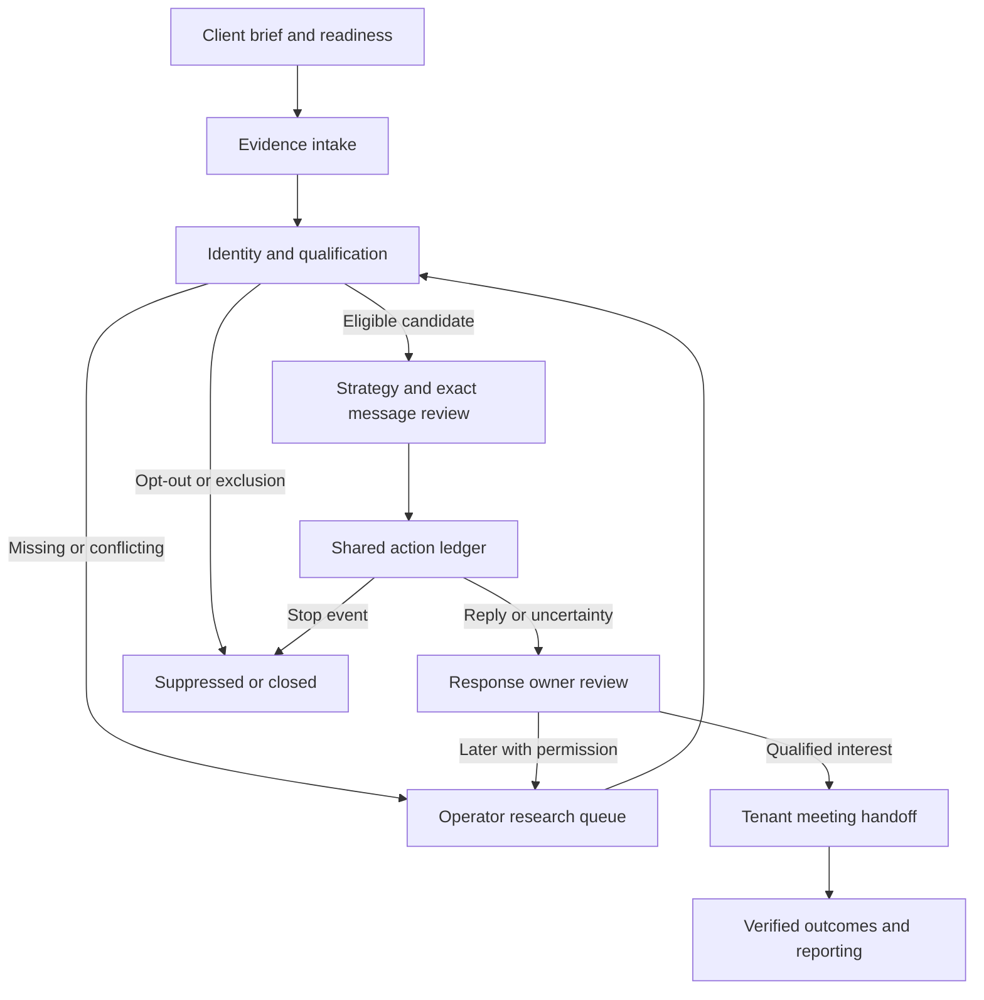

# Ripe Piper lead lifecycle specification

This is the authoritative behaviour spec for the client lead lifecycle: how evidence becomes a qualified prospect, a reviewed message, a recorded effect and a verified outcome. Delivery status, backlog and release blockers live in [DELIVERY.md](DELIVERY.md); platform routes, env vars and migrations in the [platform README](../platform/ripe-piper-platform/README.md). Paths below use `P = platform/ripe-piper-platform`.

Sections 1–8 are the target contract. Section 9 describes contracts the code implements today. Section 11 lists the gaps. Where this spec and the code differ, section 9 describes what the code does and the difference is listed as an open item.

Nothing here authorises live outreach, provider connections, paid services or production deployment. Production deploys stay blocked and provider jobs default off.

## 1. Product concept and actors

Ripe Piper is a managed lead-generation service. Operators configure each client after discovery; clients do not build automations or run a self-service product. The same code serves every client from its own configuration and evidence. A sample client (for example Anvukta) must never become an application default for offer, segment, geography, copy or credentials.

| Actor | Authority |
|---|---|
| Ripe Piper staff | Platform admin (`profiles.is_admin`). Owns the engagement, verifies evidence, prepares and approves campaigns, operates actions, changes client user roles. |
| Client owner | The client's own admin: owns its offer, sender identity, permitted sources, audience limits and commercial decisions; accepts and pays quotations, updates deals. No platform administration and no use of another client's provider. |
| Client viewer | Read-only access to their own organisation's permitted information. |
| Prospect | External person. A target account, a contact and an authenticated client user are different concepts. |

Role rules are in the root [README](../README.md#roles).

Ripe Piper's own customer acquisition (public consultation, calculator, newsletter, agency opt-out) uses `tenant_id = null` and stays separate from client delivery. Client campaign operations require a non-null tenant and exact tenant credentials. Ripe Piper dogfooding is an ordinary configured tenant, not a fallback to the public pipeline.

## 2. Implementation map

Terms: **implemented** means working code with synthetic test coverage; **partial** means a useful component that lacks required integration; **missing** means not built. A TypeScript type or a visible button alone is not implementation. No row means live operation: real senders, OAuth and payment keys are not configured.

| Capability | Code | State |
|---|---|---|
| Client and brief | `P/src/foundation/tenants.ts`, `prospecting-routes.ts:saveBrief`, versioned `business_briefs` | Implemented. Turning a website or interview into an approved brief is manual. |
| Client setup | `foundation/revive-setup.ts`, `revive_setup_context` | Implemented and shared by Revive and Signal despite the name. Sender, domain and calendar entries are supplied facts, not proof of provider access. |
| Import and identity | `prospecting-routes.ts:importReviewLeads`, unique normalised email per tenant | Implemented bounded import with per-tenant dedupe. Company is free text; organisation resolution, employment checks and cross-email person merging are missing. |
| Prospect review | `prospecting-routes.ts:prospectShortlist`, RPC `review_prospect_snapshot` | Implemented as one bounded snapshot (section 9.6). No pagination beyond 100 contacts. |
| Signal source import | `foundation/signal-sources.ts` (`status`, `preview`, `import`) | Implemented for one approved JSON feed that already supplies email. No polling, source health or contact finding. |
| Signal discovery | `foundation/signal-discovery.ts`, `site/assets/signal-discovery-admin.js` | Implemented operator-run account research (section 9.2). Not a crawler; no scheduler. |
| Qualification | `foundation/prospecting.ts:assessProspect`, `products.ts:reviewProducts` | Implemented four dimensions with unknown/conflict/excluded and freshness. Literal evidence matching, not semantic verification. No conversion probability. |
| Strategy and drafting | `campaigns.ts`, `revive-strategy.ts`, `revive-draft.ts`, `signal-strategy.ts` | Revive: reviewed strategy and deterministic cohort drafts. Signal: one-recipient proposal, save and review (sections 9.1, 9.3). Cohort drafts omit a contact's private facts. |
| Execution | `campaigns.ts`, `action-reliability.ts`, `revive-automation.ts`, `outbound_actions` | Fenced synthetic sink only (`SYNTHETIC_SINK_ENABLED`, `.invalid` recipients). Revive automation is default-off (`REVIVE_AUTOMATION_ENABLED`). No live client outbound executor. |
| Replies and conversations | `conversation-review.ts`, `products.ts` | Implemented reviewed thread ownership, reopening and recorded-reply stops. Question/referral/out-of-office classification, durable ingress and SLA tracking are missing. |
| Contact stops | `foundation/tenant-unsubscribe.ts`, `site/unsubscribe.html` | Implemented tenant-scoped stops and unsubscribe links (section 9.7). |
| Email and calendar | `foundation/connections.ts`, `lib/google.ts` | Read-only selected-message import behind durable authority (sections 9.5, 9.8), `canSend:false`. No Gmail/Calendar push, no durable sync cursor. |
| Meetings | `routes/public.ts`, `lib/booking.ts`, `jobs.ts` | Ripe Piper consultation booking only. Tenant-bound booking, client branding and Signal-to-meeting attribution are missing. |
| Events | `foundation/events.ts` | Synthetic registration, cancellation, rescheduling and reviewed attendance (`EVENT_REGISTRATION_ENABLED`, `.invalid` only). Live identity checks, invitations and attendance ingestion are missing. |
| Outcomes and reporting | `products.ts`, `revive-report.ts`, `deals` | Scoped outcomes and Revive action attribution. No cross-product funnel or experiment assignment; `abComparison.available` is false. |
| Privacy requests | `foundation/requests.ts`, `subject_requests` | Request capture and objection stop. Identity checks, fulfilment and retention remain operator work. |
| Operator/client UI | `site/assets/admin.js` and product admin modules, `portal.js` | Admin CRM and scoped client portal over the same API. |

## 3. Lifecycle and module ownership

The lifecycle is a projection over existing records, not one persisted master status. A contact can be fit, suppressed and linked to a past meeting at the same time; a single linear status must not erase that.

| Module | Owns | Boundary |
|---|---|---|
| Shared services | Versioned brief and setup, identity, source evidence, rights, campaign assets, action ledger, connection authority, reporting | One store and one execution service. No per-product sender or research store. |
| Signal | New prospect discovery, business triggers, source freshness, fit review | Sends a cited candidate to shared strategy. A public event triggers research, not permission or inferred purchase intent. |
| Revive | Existing relationship history, dormant-lead eligibility, reactivation rationale | Checks prior objection, stale context and current relevance. No automatic re-enrolment after silence. |
| Response | Conversation ownership, reply triage, follow-up decisions, meeting handoff | Today: manual review. Sending goes through the shared ledger and provider service. |
| Events | Event provenance, registration, attendance, event-specific relevance | Same rights and follow-up ledger. Registration does not authorise unrelated prospecting. |

Every work item carries tenant, lead, source product, owner, current version, reason, due time where relevant and a justified next action. Until a general contact owner exists, use campaign operator and conversation owner; never show an owner derived only from the last editor.

Show these independently: account fit; verified role relevance; signal credibility and freshness; contact identity confidence; outreach eligibility by purpose, channel and market; observed engagement; commercial outcome. Null means unknown. Opens, clicks, estimated company size and anonymous browsing never establish human interest, identity or budget.

## 4. Personalisation policy

Use the least expensive approach that has enough relevant evidence: the client's permitted material first, then an approved public source. Stop at the research cap and keep unknowns visible. Proposed pilot caps (configuration to validate, not current runtime limits): three source pages and ten operator minutes per candidate before review.

| Approach | Evidence needed | Rule |
|---|---|---|
| Expansion, hiring, launch, leadership change | Dated first-party announcement, entity match, current role if used | Ask how the change affects a relevant workflow. Do not claim it causes pain or creates budget. |
| Website or enquiry observation | Reproducible read-only steps, URL and time, expected vs observed | Share one verified observation. No invented audit, no real enquiry submissions or intrusive testing. |
| Useful work upfront | An actually completed diagnostic or recommendation with sources and limits | Say exactly what was reviewed; a superficial look is not a comprehensive audit. |
| Role relevance | Evidence of current responsibility, not an inferred title | Missing responsibility means research or a routing question. |
| Prior enquiry, proposal or objection | Tenant-owned dated history, identity match, permitted purpose, current objection state | Refer accurately to the prior request; never fake familiarity. |
| Case evidence | Approved case record, outcome definition, disclosure permission, comparable scope | No fabricated logos, savings or unfair comparison. |
| Introduction or walkthrough | Real introduction permission or a completed walkthrough | Name an introducer only when authorised. |
| Language, channel, timing | Client policy, reviewed language support, contact authority | Permitted channel, reasonable local time; never infer sensitive traits from names. |

Proposed review outcomes (not database enums): `ready_for_operator_review`, `insufficient_evidence`, `needs_review`, `do_not_contact`. A model may suggest an approach, extract evidence or draft copy; deterministic checks control scope, versions, exclusion and authority. The reviewer checks that the source supports the wording, including implied causal claims.

Each factual clause should carry a claim ID, source observation ID, supporting excerpt, observation time and a class: fact, client assertion, hypothesis, conflict or unknown. Unsupported assertions fail review. A hypothesis is phrased as a question or removed. Source text is never treated as instructions. AI cannot add permissions, tools, recipients, meetings or claimed results.

Signal starts with one lead per campaign, one reviewed offer and one message bound to the exact recipient (section 9.3). Multi-recipient personalisation would need an immutable rendered-message snapshot per action, not edits to a shared template. Revive cohort copy stays generic.

## 5. Trigger and action contract

This is the target matrix; section 2 says what exists. Shared profiles:

- **G (guard):** authenticated actor or service, exact tenant/lead/campaign scope, current versions, permitted purpose/channel/market, no stop, current connection. For contact also: current identity, exact approved content, budget and capacity. Research-only actions need no send authority.
- **E (expiry):** earliest of source expiry, source freshness limit, brief/setup/approval/rights expiry, connection expiry and any promised contact window. A later signal cannot refresh older evidence. Client policy may be stricter than Signal's 30-day maximum freshness.
- **R0:** replay of the same key returns the stored result; changed content with the same key conflicts. No automatic retry of a rejected business decision.
- **R1:** read-only transient failure: bounded exponential backoff with jitter, honour `Retry-After`, at most three attempts within E, then an owner exception. No retry for denied consent or identity.
- **R2:** side effect: reserve once, fenced claim, final guard, submit once. A lost or ambiguous response goes to review, never a blind resend.
- **A (audit):** tenant, correlation key, source ID/hash, occurred and received times, actor, before/after state and version, evidence/approval/rights references, reason, attempts and effect receipt. No tokens or inbox payloads in logs. An audited exclusion counts as much as a success.

| Trigger | Preconditions | Action and state | Human role | Expiry; retry; audit |
|---|---|---|---|---|
| Setup saved or blocked | Current brief, offer/exclusions, sender, working hours, capacity, approver; connection status separate | draft→reviewed or blocked; show missing facts; never auto-activate sending | Operator reviews client assertions; client approves scope | E; R0; A+setup version |
| Lead imported or matched | Source entitlement, valid schema, normalised email and tenant, unambiguous match | new→research, or attach provenance to the existing tenant lead | Review batch and uncertain identity | E; R0; A+row/digest/match basis |
| Duplicate, invalid or excluded import | Same source key and digest, or exact rejection reason | Return prior identity or reject the row | Resolve conflicts; no silent merge | E; R0; A+target or error |
| Signal detected or refreshed | Matched organisation/contact, dated source, bounded expiry | research_required; add an observation, never overwrite | Review relevance | E; R1 fetch/R0 import; A |
| Signal contradicted or expired | Conflicting evidence or past validity | needs_review/stale; invalidate dependent drafts/approvals, hold pending actions | Resolve or refresh | Immediate; R0; A+invalidated items |
| Qualification passed | Supported fit, role, need; no exclusion; signal relevance reviewed | candidate→strategy_review; rights stay separate | Accept with reasons | E; R0; A+versions |
| Qualification failed or incomplete | Exclusion or missing/conflicting dimension | Research queue or excluded; never invent need or budget | Research or close | E; R0/R1; A+reasons |
| Campaign ready or readiness lost | G plus message/recipient/source bindings | approved/eligible or held; eligibility never revives cancelled work | Approve the exact asset once; material change needs a new version | E; R0; A+snapshot |
| Message approved or scheduled | Exact text, recipient, approver, valid schedule | draft→approved→queued, once per step/recipient/version | Operator approves | E and working window; R0; A+content hash |
| Send due | G rechecked after claim and just before the provider | queued→claimed→accepted only with a receipt | Exception owner handles uncertainty | E; R2; A+fence/provider ID; acceptance is not delivery |
| Send failed or bounced | Provider failure or verified bounce tied to the action | failed; uncertainty→review; hard bounce suppresses the address | Review ambiguous failures | Immediate stop on hard bounce; R2; A |
| Interested reply or question | Verified inbound sender/thread/tenant, not an automated receipt | Stop prospecting, open conversation | Owner verifies interpretation and answer | Stop on receipt, not on classification; R0; A+inbound ID |
| Referral or wrong person | Actual referral text | Stop old sequence; research task for the referred person, no inherited rights | Review new identity | E; R0; A; no automatic send |
| Objection | Verified reply and objected scope | Stop sequence; suppress or close; keep the objection | No persuasion loop | Immediate; R0; A+scope |
| Not now | Requested timing or explicit unknown | Hold; optional due task, no automatic re-enrolment | Review fresh evidence at due date | Agreed date and E; R0; A |
| Unsubscribe | Valid opt-out or conservatively recorded objection | Suppress, cancel queued actions, claimed work to review; suppression beats a positive reply | No approval needed to stop | Never auto-expires; R0; A+scope |
| Automated reply | Headers/content consistent with automation | Hold for review; not a human reply; no automatic email to a substitute | Review return date | E; R0; A |
| Follow-up due | Current sequence, no reply/booking/stop, current rights | Reserve next approved step once, otherwise hold | Review unresolved conversation | E and work window; R0/R2; A+step key |
| Meeting booked | Prospect's choice, exact tenant calendar and owner, current availability, reservation | requested→reserved→confirmed only after the matching provider event | Prospect chooses; owner reviews uncertain booking | Reservation expiry; R2; A+event |
| Meeting changed or cancelled | Authenticated provider revision or valid party action | Update the same meeting; cancel stale reminders; hold prospecting | Cancellation is never new outreach permission | Immediate; R0/R2; A+old/new |
| Meeting completed or missed | Attendance evidence and reviewer | held, verified_no_show, or attendance_unknown | Owner verifies; no inference from the clock | Outcome window; R0; A |
| Opportunity won/lost/paused | Client-reviewed evidence and deal link | Keep deal stage and reason distinct | Client sales owner decides | Cohort window; R0; A |
| Reactivation eligible | Dated prior relationship, fresh fit/rights, no objection, renewed relevance | Revive eligibility review; no reset of cancelled sequences | Review changed context and exact message | E; R0; A |
| Integration disconnected | Failed identity/scope/health check or expired cursor | Block dependent actions; keep unrelated safe work | Operator repairs or uses manual intake | Until verified recovery; R1 reads only; A |
| Delivery health drops | Provider denial, complaint, bounce or incident | Pause sender/campaign; investigate before resuming | No automatic sender rotation | Immediate; R0; A |
| Event registration/attendance | Valid event identity, registration scope, complete attendance source | registered→attendance state→follow-up review; no-show only when verified | Verify identity and roster | Event end plus E; R0/R2; A |

**Ordering and concurrency.** Persist authenticated inbound identity and a conservative lead hold before any asynchronous classification. Serialise claim and stop decisions on the same tenant lock; use the existing version checks and fence tokens. Deduplicate inbound on tenant + connection + provider event, outbound on tenant + campaign + asset + lead + step. A delayed event must not overwrite newer state, lift suppression or regress a confirmed outcome; keep both occurred and received times.

The database cannot recall a message already handed to a provider. If a reply lands after final preflight, stop future steps, reconcile the in-flight effect and report the race. Never promise exactly-once delivery across a network. A stale inbox cursor must block autonomous follow-up, not just show a warning.

**Suppression scopes (current code).** A tenant objection writes `lead_suppression` for that one tenant and lead only (section 9.7). The Ripe Piper public opt-out writes `agency_suppression`. Existing rows in the global `suppression` table are still honoured everywhere, but no new tenant objection creates one. Other clients never see a source client's reason or history.

## 6. Data and integration design (proposed)

No new infrastructure or graph database is needed. Keep the Worker, Supabase, CRM and campaign ledger; use tenant-scoped joins for evidence. Everything in this section beyond what section 9 describes is proposed, not built.

| Entity | Reuse | Proposed extension |
|---|---|---|
| Client/actor | `tenants`, `profiles`, `memberships` | Shared readiness projection; later scoped operator assignment. |
| Brief/setup | `business_briefs`, Revive setup | Extract shared readiness checks without breaking Revive. |
| Account/contact | `leads.company/website/email`, observations | Reviewed domain evidence and manual resolution of ambiguous matches. Domain is not legal identity; never auto-merge personal emails. A separate accounts entity waits until multi-contact account workflows need it. |
| Evidence | `lead_observations` | Typed claim provenance and conflict/supersession references; never rewrite history. |
| Strategy/message | `campaigns`, versioned `campaign_assets`, `signal_strategy` | Multi-recipient rendering later needs a per-action rendered snapshot. |
| Rights | `contact_rights`, `lead_suppression`, `suppression`, `outbound_stops` | Provider connection permission stays distinct from contact authority. |
| Execution | `outbound_actions` with fence/lease/receipt fields | Explicit live execution mode with immutable recipient/message/connection snapshot and provider acceptance evidence. |
| Inbound | Response observations, thread review, `activity_log` | Provider message/thread correlation, automation classification, sync cursor and health. |
| Meeting/opportunity | `meetings`, reservation protections, `deals` | Tenant-bound campaign/lead/trigger and provider event revision; client sender and branding. Public consultation capabilities are never tenant booking authority. |
| Experiments | Campaign/asset/action/outcome records | Predeclared experiment arm and assignment, operator minutes, cost receipts. |

A cross-product handoff extends `P/src/contracts/v1.ts:Handoff` compatibly: schema version, tenant, lead, campaign and asset version, source product, correlation key, source observation IDs, brief/setup/connection versions, actor, occurred/received times, intended action, evidence mode. Receivers re-read authoritative rows. A payload flag such as `approved:true` never grants rights.

**Email sending (missing).** Must verify OAuth mailbox identity, allowed send-as identity, client configuration and revocation. A client must never inherit the platform `MAIL_FROM`. A read-only connection is not upgraded to send because a refresh token exists. Gmail acceptance is not delivery. An uncertain send stays held until reconciled or closed by hand.

**Ingress (missing).** Start with bounded, permissioned mailbox sync using existing adapters and a durable cursor. Gmail push can come later: watches need renewal and history can expire, so recover with a bounded resync and hold follow-ups during the gap. Never ingest an unrelated inbox. Calendar notifications require fetching the changed resource and checking tenant/calendar/event identity.

**Tenant booking (missing).** Use the selected tenant calendar, check availability right before reserving, allocate a stable event ID and reconcile the same event on uncertainty. Store UTC instants plus an IANA timezone; test DST and overlaps. Confirm only when event ID, attendee, start/end and conference match. Never create an invitation as a side effect of research or a classifier label.

## 7. Operator and client experience

Extend the existing admin workspaces and portal. Primary actions are real backend operations or are disabled with the exact missing prerequisite; a preview never says "sent" or "booked".

| Workspace | Primary control | States to show |
|---|---|---|
| Clients | Brief/setup review, connection identity and readiness | Loading, incomplete, stale version, disconnected, verified-at, denied. A saved setup is not verified infrastructure. |
| Signals/prospects | Discover, preview/import, inspect fit, accept/reject/research, prepare strategy | Empty, expired, conflicting, suppressed, duplicate, error, capacity bound; source link and reason. |
| Campaigns | Exact recipient text and evidence, approve/pause, scheduled steps | Draft/dirty/stale/approved/held/uncertain; no enabled send when a guard fails; client and sender always visible. |
| Conversations | Assign owner, classify, answer, defer, hand off | New/assigned/reopened, overdue, automated/uncertain, stop status, source thread. |
| Meetings/events | Reconcile, change/cancel, verify attendance | Requested/reserved/uncertain/confirmed/cancelled/attendance_unknown/held/no-show; timezone visible. |
| Exceptions/reporting | Reconcile one effect; explain stalled progress | Failed vs uncertain, next owner action, attempts; test vs provider acceptance vs human engagement vs commercial outcome. |

Viewers get scoped summaries; owners supply corrections and commercial outcomes; staff handle technical exceptions. Never expose another client's data through search, export, counts, cached panels or error text. Async UI must discard responses that arrive after a tenant or selection change, keep safe retry keys and announce loading and errors accessibly. Paused campaigns resume by editing the messages (new version) and re-approving.

## 8. Feasibility, privacy and cost

A website describes services and an announcement describes an event; neither establishes contact permission, real pain or purchasing authority. Record source access, permitted reuse, freshness and review effort per client. Automated crawling, paid enrichment and social scraping are not needed for the first complete path.

Record Ripe Piper's and each client's controller/processor roles for the actual purpose. Keep minimum business contact data; reject sensitive attributes, unrelated inbox material and unnecessary tracking. Source collection and marketing contact are separate decisions: record purpose, jurisdiction and channel, lawful basis or permission, notice, source terms, reviewer, expiry and objection handling. Unresolved jurisdiction or permission means hold. UK B2B rules distinguish recipient types (a work address is not blanket permission); EU rules require transparency and objection handling; UAE and free-zone rules must be checked per client and channel. There is no single "GDPR compliant" switch.

Use tenant-scoped RLS, minimal grants, server-only secrets, redacted logs and revocable connections. Set a per-client retention purpose and review date before importing business data. Unverified research should expire from active use. `subject_requests` does not automate fulfilment. After erasure keep only the minimal suppression record needed to prevent recontact.

Cost: paid automation stays off while price or usage is unknown (`PAID_AI_ENABLED` defaults off). Do not provision Pub/Sub, enrichment, ads or other paid services for this lifecycle. Google Ads sync (`ADS_SYNC_ENABLED`) only feeds optional ad spend into the client cost report, no package needs it, and enabling it requires the `adwords` OAuth scope.

For a future live email pilot: verify domain authentication, authorised sender and provider policy; stop on any complaint or wrong-recipient incident; no artificial warm-up, sender rotation, deceptive tracking or inbox-placement guarantees.

## 9. Implemented contracts

### 9.1 Signal strategy preparation

`POST /api/admin/tenants/:tenant/campaigns` with `{operation:'signal-proposal',body:{leadId,signalId,synthetic}}` (exactly those keys; UUIDs and a Boolean). Code: `campaigns.ts` → `signal-strategy.ts:prepareSignalProposal`. Staff only. The caller cannot supply sender, copy, brief, evidence or approval. Nothing is written and no provider is called.

- **Errors:** malformed input 400; missing tenant or lead 404; incomplete, stale or held setup/evidence/fit 409; malformed dependency data or transport failure 503.
- **Reads:** active tenant, exact tenant lead, current reviewed setup and brief (`revive_setup_context`), all same-tenant/same-lead/same-mode observations (limit 1001, held at 1000), lead and global suppression.
- **Holds:** setup not ready; non-English setup language; trigger not in `reviewProducts` with state `prioritise_review`; `assessProspect` state not `candidate`; any recorded Response reply or enquiry (raw, before review filtering); suppression; expired evidence; unsafe plain text.
- **Copy:** deterministic English. One subject and body asking whether a conversation about the canonical need would be useful, the reviewed offer, the sender name and a stop line. The trigger relevance is labelled a hypothesis. No follow-ups.
- **Response:** `{ok:true,proposal,delivery:'not_sent',contactAllowed:false}`. `proposal` has `tenantId, leadId, signalId, synthetic, briefVersion, setupVersion, recipient, sender{name,email}, preparedAt, validUntil, strategy{canonicalNeed,buyerRole,offer,triggerHypothesis,cta}, message{subject,body}, evidence[], claimSources{canonicalNeed[],buyerRole[],offer{reference,observedAt,excerpt}}, reviewRequired:true, persisted:false`.
- **Bounds:** tenant name 200; need/role 100; offer and trigger hypothesis 500; sender name 80; email 254; excerpt 2000. Plain-text fields reject control characters, markup and template delimiters.
- **Expiry:** `validUntil` is the earliest of trigger validity and brief/fit evidence age cutoffs. Equal to now counts as expired.
- **Drift check:** the snapshot is read twice and compared in canonical form (sorted keys and rows); any change returns 409. This detects drift; it is not an atomic snapshot. Save and approval re-validate in SQL (section 9.3).
- **UI** (`site/assets/signal-admin.js`): "Prepare strategy" on eligible cards only. Validates envelope, identity, versions and time before rendering inert text. Clears on tenant change, refresh, new request or expiry; request tokens reject late responses.

### 9.2 Signal discovery

`POST /api/admin/tenants/:tenant/signal-source` adds `discovery-status`, `discover` and `analyse-posts` alongside the existing `status`, `preview` and `import`. Code: `foundation/signal-discovery.ts`; UI `site/assets/signal-discovery-admin.js`. This is read-only account research: every success says `contactAllowed:false, delivery:'not_sent', persisted:false` and binds `tenantId` and `synthetic`. No table, migration, scheduler or sending action.

**Configuration (server-only).** `SIGNAL_DISCOVERY_SOURCES` is a JSON array of at most 20 entries with exact keys `{id,tenantId,kind:'greenhouse'|'lever'|'business_feed',board,company,companyDomain,industries,permissionReference,expiresAt,enabled,synthetic,region?:'global'|'eu',url?}`: UUID id and tenant, company 240, industries at most 20 labels of 100, permission reference 240. `business_feed` needs an HTTPS `url` whose host is in `SIGNAL_DISCOVERY_FEED_HOSTS` (at most 20 public hostnames). A malformed registry fails closed; disabled or expired entries are skipped. Entries are selected only when their `synthetic` matches the request. Company and industry are operator declarations, never inferred from a board slug. Lexical URL checks are not DNS/egress protection; that is a hosted-release dependency.

**Fetching.** Destinations are built only from known hosts: Greenhouse `https://boards-api.greenhouse.io/v1/boards/{board}/jobs?content=true`; Lever `https://api.lever.co/v0/postings/{board}?mode=json&limit=100&skip=0` (`api.eu.lever.co` for `region:'eu'`); the configured feed URL. One page per source, 15-second timeout, bounded body, JSON only, at most 100 rows. No caller URLs, redirects, cookies, POSTs or detail-page crawling. No automatic retry; 429/403/transport errors become a held source with a bounded `retryAfterSeconds`. A full Lever page or Greenhouse total above the received count marks the source incomplete. Repeat collection is operator-driven.

**Parameters** (`discover` and `analyse-posts`): exact `{industries,geographies,keywords,excludeKeywords,targetRoles,lookbackDays}`. Each array has at most 10 distinct terms of 1–100 characters; keywords, geographies and target roles need at least one. `lookbackDays` is an integer 1–90. Markup and template characters are rejected. Matching is literal, case-insensitive, on Unicode word boundaries: at least one keyword in title or text and a geography in the location. Exclusions win. `targetRoles` are desired buyers, not evidence about a job applicant. There are no runtime defaults.

**Candidates** carry no email: `{id,sourceId,company,companyDomain,sourceUrl,title,excerpt,location,indicator,sourceDate,dateKind,deadline,observedAt,matchedKeywords,targetRoles,priority:'research',contactState:'unknown',intent:'unverified',industryBasis:'operator_declared',synthetic}`. Job rows use the neutral indicator `job_posting`. Feed and export indicators: `company_post, supplier_request, expansion, product_launch, operational_problem, directory_listing, event_participation, first_party_enquiry, referral`.
- Reference URLs: HTTPS, no credentials, ports or fragments, public non-IP host, at most 1000 characters. They are never fetched.
- Excerpt: at most 1200 characters of inert text.
- Dates: Greenhouse dates are `updated`; undated Lever rows are `unknown`. Rows outside the lookback window are excluded, and expired `supplier_request` deadlines are filtered. Both checks are re-run at response time.
- Output: at most 100 candidates; hitting the cap marks the result incomplete.

**`analyse-posts`** takes `{parameters,synthetic,permissionReference,reviewed:true,posts}` with at most 50 operator-supplied records. Each record has exact fields `{id,company,companyDomain,sourceUrl,publishedAt,title,text,location,industry,indicator,deadline}`. Bounds: id 80, company/title/location 240, text 2000, industry 100.
- `supplier_request` needs a deadline. Only `directory_listing` may have a null `publishedAt`.
- Duplicates are removed by domain + canonical URL. Export candidate IDs are `operator-export:` plus a SHA-256 hash.
- `postingActivity` counts only retained `company_post` records per domain, with `sampleOnly:true`. A count is descriptive, not buying intent.
- A `business_feed` response is `{items:[same records],complete}` with at most 100 records.

**Response:** `{ok:true,tenantId,synthetic,candidates,sourceResults,complete,searchQueries,...}`. `sourceResults` entries have `sourceId, state ('ok'|'incomplete'|'held'), count, excluded (invalid + filtered), reason, retryAfterSeconds?`. A held source, invalid evidence, a cap or no eligible source forces `complete:false`. `complete` only describes the configured sources, never internet coverage. `searchQueries` are at most 5 plain suggestions and are not executed.

**Rules.** Discovery never grants outreach authority. No warm/hot label from keywords or counts. A warm label needs separately verified fit, need and expressed interest. A real contact enters through the existing intake and qualification before strategy preparation. Social profiles are not scraped. Native RSS/Atom, search APIs and procurement portals are not implemented; add adapters against this contract only after access, licence and cost are established.

Indicator guidance (hypotheses for review, not conversion claims):

| Indicator | Evidence | Counter-evidence to review |
|---|---|---|
| Sales-development hiring | Employer posting for SDR/BDR/lead generation with relevant duties | Replacement, evergreen vacancy, agency, internal-hiring preference; never proves outsourcing interest |
| Supplier request | Dated first-party request or tender, deadline retained | Vendor marketing, closed deadline, unrelated market; respond only through the issuer's route |
| Expansion or launch | Dated first-party announcement | Republication, aspiration only; no assumed budget |
| Company posting | Distinct dated posts in the window | Syndication, reposts, incomplete sample |
| Stated problem | Exact first-party statement about pipeline or follow-up | Educational copy or another company's case study |
| Directory listing | Permitted listing with industry and location | Fit only; never harvest member personal details |
| Event participation | Public exhibitor/speaker or organiser records | Attendance gives no email consent |
| Enquiry or referral | Authorised business-level export | Rights reviewed separately; no invented introduction |

### 9.3 Signal strategy persistence and synthetic execution

Migration `20261026034704_signal_reviewed_execution.sql` adds `campaign_assets.signal_strategy` and `campaign_assets.signal_review`. It also adds SQL helpers (`signal_strategy_context`, `build_signal_strategy`, `signal_binding_valid`, `signal_campaign_strategy_current`, `guard_signal_*`, `invalidate_signal_strategy`) and extends `manage_campaign_plan` and `synthetic_action_allowed`.

- **Save:** the campaign `save` operation accepts `signalStrategy:{leadId,signalId,synthetic:true,proposal,reviewed:true}` (exact keys), product `signal`, one step at offset 0, subject at most 160, body at most 4000, and `evidenceReference` exactly `signal:<signalId>`. The server rebuilds the proposal from the authoritative SQL context and compares it, ignoring `preparedAt`. The operator may edit subject and body; the reviewer's attestation covers the factual support of the final copy. Software verifies bindings and current evidence, not semantic truth.
- **Binding:** SQL stores the proposal, source context fingerprint, final steps, reviewer, recipient, sender, versions and source expiry. It derives a 64-character SHA-256 binding digest itself; client digests, snapshots, reviewer and expiry are never trusted. An identical save returns the same version. Any material change, including changed evidence with unchanged copy, creates a new immutable asset version. A bound campaign cannot drop its binding through a generic save.
- **Approval:** `approve` needs `signalReview:{digest,messageReviewed:true,evidenceReviewed:true}`, the exact persisted digest and current sources. Approval expiry cannot exceed evidence expiry. Signal execution needs the `signal_review` receipt, not just `approved_by`. Manual Signal drafts without a binding can be saved but not approved or executed.
- **Execution:** queue needs the bound lead, one message, current approval and contact rights, `SYNTHETIC_SINK_ENABLED` and a `.invalid` recipient. Claim and completion keep fence tokens, replay identity, uncertain-result review and stop checks. SQL triggers enforce the binding at insert, claim and completion. Signal `delivered` is forbidden. Older queued or manual actions cannot bypass the gate. Failures surface as "Signal execution requires a current saved strategy and exact reviewed approval." (409).
- **Invalidation:** changes to lead identity/status, observations (insert/update/delete), setup or brief versions take the tenant lock and invalidate affected approved campaigns. The campaign returns to draft, the approval version advances, queued actions are cancelled and claimed actions go to review. Terminal history is kept. Expiry, suppression, replies, outbound stops and tenant pause are rechecked at every guard even without an edit. Reviewer eligibility (current verified admin) is rechecked at every guard.
- **UI:** the Signal panel transfers a proposal to the campaign panel (`campaigns-admin.js`) without saving or approving. A copy edit clears review until saved. Uncertain mutations offer a reload of the same campaign, never an automatic retry.

### 9.4 Revive execution guards

Migration `20261026041450_revive_egm_execution_guards.sql` tightens SQL so service-role callers get the same answers as the Worker:

- Accepting a Revive cohort and later candidate checks use a SQL fit predicate equal to the Worker's four reviewed dimensions. It covers aliases, exclusions, ambiguity and conflicts, and ignores stale, unreviewed, wrong-mode or invalid observations. Raw fact and excerpt lengths are checked before trimming. Explicit rejections stay allowed.
- The actual message approver must still be a current admin with a confirmed Auth email at queue, claim and completion (`revive_slot_authority_current`).
- Queued future steps may be reserved before earlier steps finish. Claimed and tested actions use the full `synthetic_action_allowed` predicate, including predecessor completion.
- Completion requires a prior claimed state with an unchanged non-null fence, unchanged identity and versions, a bounded lease and the exact test-sink receipt. There is no live `delivered` transition on this path. The two-step claim (claimed, then fence write) is preserved.
- Initial claims need a finite lease later than `greatest(now(), due_at)` and at most 3 minutes after it. The RPC uses 2 minutes.
- Terminal receipts are frozen and replayable after later stops without a new effect.
- The Revive report's `replyHeld` counts any raw same-tenant/same-lead Response reply or enquiry for enrolled contacts once per campaign. A hold is not a verified human reply. Report refreshes use a monotonic request ticket, so an older response cannot overwrite a newer one.

Migration `20261031000000_revive_draft_matched_need_only.sql`: only the brief need that matches the reviewed source must be valid draft text. An unrelated unsafe need no longer blocks drafting.

### 9.5 Gmail import pause fence

Migration `20261027000003_gmail_pause_fence.sql`. A reviewed Gmail import captures the tenant execution version before provider reads. Persistence locks the same tenant row as pause, requires that version and an active tenant, and checks connection expiry before recording the event and reply holds in one transaction. If the pause commits first the import is rejected; a pause followed by reactivation also invalidates the earlier version. Persistence now goes through `record_authorized_gmail_event` (section 9.8).

### 9.6 Bounded prospect review snapshot

Migration `20261027190653_safe_bounded_prospect_snapshot.sql`; Worker `prospecting-routes.ts:prospectShortlist`. It replaces separate table reads (which PostgREST could silently cap) with one service-only RPC `review_prospect_snapshot(p_tenant, p_actor, p_synthetic)`. `p_actor` always comes from the authenticated user, never the request body.

- **Actor:** a profile with `is_admin=true`, joined to `auth.users` with a confirmed email that matches case-insensitively. Otherwise `{version:1,status:'unauthorized'}` (403). Missing tenant: `missing` (404). Any capacity gate: `capacity` (409). Anything else: 503, with no fallback to independent reads.
- **Capacity:** at most 100 contacts (probe 101), 999 observations (probe 1000) and 100 verified owners. Raw admin and tenant-owner candidate probes are capped at 101 each, before email checks.
- **Byte caps:** per-row raw bytes are lead 8192, observation 65536, brief 262144, profile 4096, with a 1 MiB total. Byte counts come from stored generated `prospect_review_bytes` columns, so the read path checks sizes before fetching wide values. These columns are excluded from Revive and Signal fingerprints.
- **Success:** `{version:1,status:'complete',tenantId,synthetic,snapshotAt,brief,leads,observations,stoppedLeadIds,owners,leadCount,observationCount,ownerCount}`.
  - `brief` is the latest version, or null.
  - Leads return `id, company, email, status`.
  - Observations return every row for the tenant and mode, with no freshness prefilter.
  - Stops cover `status='unsubscribed'`, `lead_suppression` or global `suppression`.
  - Owners are verified admins or tenant owners. The label is the full name or the email, truncated to 320.
- **Worker:** an 8-second request deadline over the full body read and an 8 MiB response ceiling. It validates canonical lowercase UUIDs, counts, uniqueness and shapes. `snapshotAt` must be within -5 s to +60 s of the single `assessedAt` used for every assessment; both times are returned. A read never authorises a mutation.

### 9.7 Tenant contact stops

Migration `20261027194035_tenant_contact_stops.sql`; Worker `foundation/tenant-unsubscribe.ts`; UI `tenant-stops-admin.js`, `site/unsubscribe.html`, `tenant-unsubscribe.js`.

**Stop effect** (internal `apply_tenant_contact_stop`, under the tenant lock): it affects exactly one `(tenant_id, lead_id)`.
- Inserts `lead_suppression` (reason `objection`).
- Denies current contact rights with the objection time.
- Cancels queued actions and moves claimed actions to review. The lease is cleared; dispatch tokens, receipts and terminal history are kept.
- Lead lifecycle and deal state are unchanged. It works for paused and onboarding tenants.
- `freeze_on_objection` and Response opt-out events use the same scoped stop and no longer create global suppression.
- Already dispatched requests cannot be recalled. Uncertain receipts stay in review.

**Staff route:** `POST /api/admin/tenants/:tenant/leads/:lead/unsubscribe`. SQL independently requires a current verified admin. Unexpected fields are rejected.
- `{operation:'record',reference}`: the reference is 8–240 characters. `record_tenant_unsubscribe` returns `{version:1,status:'stopped',tenantId,leadId,alreadyStopped}`. Activity provenance is logged once per new stop, without the token or email.
- `{operation:'issue_link'}`: generates 32 random bytes as a 64-character lowercase hex token. Only the SHA-256 of that hex string is stored, in `ripepiper_private.tenant_unsubscribe_tokens`. `issue_tenant_unsubscribe` returns `issued` (201 `{version:1,status:'issued',url,expiresAt,delivery:'not_sent'}`), `limited` or `stopped` (409).
  - Links expire after 90 days; equality counts as expired.
  - Issuance is refused within 60 seconds of the previous link for that lead, or when 20 unexpired unconfirmed links exist.
  - Issuing removes that lead's expired unconfirmed tokens. Already-suppressed contacts get no new link.
  - The URL is `SITE_URL + /unsubscribe.html#token=…`, never built from the request Host. Nothing is sent.
- Other responses: 403 for a non-admin, 404 for a missing lead, 503 on uncertainty.

**Public confirmation:** `site/unsubscribe.html` removes the fragment from history, keeps the token in memory and posts only when the person clicks a button. The page has no third-party assets and uses no-referrer. `POST /api/tenant-unsubscribe/confirm` accepts only `[0-9a-f]{64}`; `confirm_tenant_unsubscribe(p_hash)` locks tenant then token, revalidates the current lead email and applies the stop.
- A valid token or a confirmed replay returns `{version:1,status:'confirmed'}`. A confirmed replay wins over expiry or a changed email and writes nothing.
- An unknown, expired or changed-address token returns `{version:1,status:'invalid'}`.
- Both return 200 with no identifiers. Malformed receipts return 503.
- GET never mutates. The link is a bearer capability: forwarding or a scanner that submits forms can use it. It is not RFC 8058 one-click.
- Tenant stops do not touch agency newsletter preferences or other tenants that share the address.

### 9.8 Durable Google read authority

Migration `20261027194016_durable_google_authority.sql`; Worker `foundation/connections.ts`. Credentials live only in Worker secrets. The private RLS table `tenant_google_authority` (one row per tenant) holds the connection ID, a monotonic version, the binding digest, expected mailbox and calendar, purpose, expiry, verified at/by and revoked state. No row is ever created automatically from secrets.

- **Digest:** lowercase hex SHA-256 of UTF-8 `JSON.stringify([1, id.toLowerCase(), tenantId.toLowerCase(), mailbox.toLowerCase(), calendarId, purposeReference, new Date(expiresAt).toISOString(), clientId, clientSecret, refreshToken])`. It is computed in the Worker, never logged or returned, and detects credential changes even when a config ID is reused.
- **Operations** on `POST /api/admin/tenants/:tenant/connection`:
  - `status` is read-only. It exposes `state, authorityVersion, canRead, canSend:false`, never the digest or credentials.
  - `check` is an identity probe that grants nothing (`tenant_google_probe_current`).
  - `register` needs `{reviewed:true,expectedVersion}`. It verifies the real mailbox and calendar against the configured binding, then calls the CAS RPC `register_tenant_google_authority`, which returns `{version:1,status:'verified',authorityVersion}`.
  - `revoke` needs `{expectedVersion}` and works without Google or valid config. `revoke_tenant_google_authority` returns `{version:1,status:'revoked',authorityVersion}`.
  - Errors: CAS conflicts 409 (SQLSTATE 40001); non-admin 403 (42501); malformed input 400 (22023); unknown outcomes 503. The connection ID cannot change across revoke/register.
- **Reads:** `list`, `preview` and `import` need an active tenant and a current, unexpired, unrevoked authority that matches the configured digest. `tenant_google_authority_current` is rechecked after OAuth, before each Gmail/Calendar request and before returning data. A pause/resume cycle invalidates the read. The token cache rejects a refresh result for credentials that changed in flight. A remote read already issued after the final check cannot be cancelled.
- **Persistence:** `record_authorized_gmail_event` verifies authority, connection and purpose under the tenant lock. External references are `gmail:<connection UUID>:<message ID>`, thread references `gmail:<connection UUID>:<thread ID>`. The legacy `record_gmail_product_event` always rejects. Generic `record_product_event` rejects any `gmail:` source reference. A `gmail:` thread reference is accepted only for a Response `outcome` linked to existing reviewed enquiry or reply evidence on the same tenant, lead, thread and mode, so revocation does not erase historical attribution.
- **Operator order for rotation:** revoke, rotate secrets separately, then register and verify again. Tenants without a registered authority fail closed.

### 9.9 Operating controls and reminder inspection

- **Flags.** `MEETING_TRANSCRIPTS_ENABLED`, `SHEETS_SYNC_ENABLED` and `ADS_SYNC_ENABLED` enable only on the exact string `true`; both `wrangler.toml` and `wrangler.staging.toml` set them false.
  - They are enforced at the exported job entrypoints and in the scheduler. Staff `processMeeting` and `runAdsSync` authenticate first, then return 409 while disabled.
  - Manual transcript processing is agency-only (`tenant_id is null`, else 404); its paid AI call still needs `PAID_AI_ENABLED`.
  - Ads errors are stored only as stable codes (`google_ads_http_<status>`, `meta_http_<status>`, `linkedin_http_<status>`, `ads_sync_failed`), never raw bodies.
  - Sheet append recovery after an uncertain write is not solved, so that flag stays off.
- **Reminder inspection:** `GET /api/admin/meetings/:id/reminder-receipts` (staff, agency meetings only, no-store) returns `{version:1,meetingId,canRetry:false,receipts:[…]}` for windows `24h` then `1h`.
  - Each receipt has `state ('absent'|'claimed'|'dispatching'|'acknowledged'|'review')`, `leaseUntil`, `acknowledgedAt`, `providerMessageId`, `requiresReview` and `delivery`. `delivery` is `not_sent` when absent, otherwise `unknown`.
  - `requiresReview` is true for the review state or an expired claimed/dispatching lease.
  - A legacy `reminder_*_at` timestamp without a receipt returns 503. Malformed receipts return 503; a missing or tenant meeting returns 404.
  - Inspection never changes a receipt and is not a retry endpoint. Tokens, recipients and raw errors are never returned.

## 10. Validation and measurement

Validation runs on local synthetic fixtures with two fictional clients (see [DEVELOPMENT.md](DEVELOPMENT.md) for commands). They must show:
- a shared email mapped to distinct tenant leads;
- distinct briefs, sources, drafts and outcomes;
- rejected cross-tenant evidence and campaign mutations;
- reply and opt-out stops;
- independent credentials.

Local PGlite tests do not prove hosted concurrent-connection behaviour, real provider identity or delivery.

| Risk | Required evidence |
|---|---|
| Tenant leakage or wrong identity | Foreign lead/source/campaign/outcome/connection denial; same-email isolation; viewer/owner/admin and stale-UI tests |
| Stale or unsupported claims | Expired brief/trigger/review, changed digest, conflicting facts, unsupported excerpt rejection |
| Duplicate actions | Import/outcome/enrolment replay, same key with changed payload, concurrent claim, cancelled work not reactivated |
| Stop before send | Persisted reply cancels queued work and fences claimed work; opt-out beats later interest |
| Provider failure | Revoked credentials, missing receipt, timeout after acceptance, reconciliation, no duplicate invitation |
| Meetings and outcomes | Wrong calendar/attendee/time, DST, double booking, unknown attendance, no causal attribution without evidence |
| External content abuse | Source text cannot change tenant, recipients, tools or claims; untrusted HTML inert; bounded payloads and controlled URLs |
| Cost and privacy | No paid call with unknown usage, minimum fields, scoped export/deletion, no secrets in logs |

**Later controlled comparison** (only once outreach is authorised). Predeclare client, offer, segment, eligibility, outcome window, allocation and stop rules. Compare A: segment message; B: verified trigger message; C: trigger plus a completed useful deliverable. Assign by account from the same eligible pool and keep the assignment stable. Keep channel, cadence and CTA comparable, and count preparation time in each arm's cost. Small cohorts give directional qualitative findings, not an A/B winner.

Metrics:
- positive human replies per provider-accepted contact;
- qualified meetings per contacted account;
- attendance per confirmed meeting;
- opportunities per held qualified meeting;
- complaints and opt-outs with denominators;
- operator minutes and service cost per qualified meeting.

Report a metric with a zero denominator as unavailable. Keep provider acceptance and delivery apart, automated and human replies apart, booked and held apart. Change one rule at a time, keep an auditable rollback, and never train on private cross-client data.

## 11. Open items

Deliberate gaps between this spec and the code. Priority and ownership live in [DELIVERY.md](DELIVERY.md).

- **Sending:** there is no live client sender. Execution is synthetic only and `canSend:false` everywhere.
- **Ingress:** reply classification (question, referral, out-of-office), durable mailbox sync with a cursor, and Gmail/Calendar push are missing.
- **Booking:** tenant calendar booking, client branding and Signal-to-meeting attribution are missing. Booking is Ripe Piper consultation only.
- **Events:** live identity verification, invitations, reminders and attendance ingestion are missing.
- **Identity:** organisation resolution, employment checks and cross-email merging are missing. Company is free text.
- **Signal discovery:** there is no scheduler, distributed rate limit, DNS/egress control, native portal or search adapter, or source health tracking.
- **Personalisation:** multi-recipient personalisation is not built, and per-clause claim provenance (section 4) is not stored.
- **Reporting:** there is no cross-product funnel and no experiment assignment (`abComparison.available:false`).
- **Privacy:** subject-request identity checks, fulfilment and retention run as manual operator work.
- **Pagination:** the prospect review returns at most 100 contacts and 999 observations.
- **Sheets sync:** uncertain-append recovery is unsolved, so the sync stays off.
- **Hosted acceptance:** the Signal, Revive, stops, authority and snapshot migrations have no evidence from hosted environments. That includes independent-connection races, real Auth/PostgREST behaviour and the database statement timeout.

## 12. References

These were checked when the design was written. They inform constraints; they do not prove accounts, quotas, legal applicability or deployed features.

- [Gmail push](https://developers.google.com/workspace/gmail/api/guides/push) and [Gmail sync](https://developers.google.com/workspace/gmail/api/guides/sync): watch renewal, expired history needs resync.
- [Calendar event insert](https://developers.google.com/workspace/calendar/api/v3/reference/events/insert) and [Calendar push](https://developers.google.com/workspace/calendar/api/guides/push): event identity, conference data, channel expiry.
- [Gmail sender guidelines](https://support.google.com/a/answer/81126): sender authentication and delivery health.
- [Greenhouse job board API](https://docs.greenhouse.io/job-board.html) and [Lever postings API](https://github.com/lever/postings-api): public reads need known board IDs; Greenhouse `updated_at` is not the publication date; Lever gives no publication time.
- [LinkedIn prohibited software](https://www.linkedin.com/help/linkedin/answer/a1341387/prohibited-software-and-extensions?lang=en) and [robots protocol (RFC 9309)](https://www.rfc-editor.org/rfc/rfc9309.html): no scraping; robots allowance is not permission.
- [ICO B2B marketing](https://ico.org.uk/for-organisations/direct-marketing-and-privacy-and-electronic-communications/business-to-business-marketing/), [ICO electronic mail marketing](https://ico.org.uk/for-organisations/direct-marketing-and-privacy-and-electronic-communications/guide-to-pecr/electronic-and-telephone-marketing/electronic-mail-marketing/) and [legitimate interests](https://ico.org.uk/for-organisations/uk-gdpr-guidance-and-resources/lawful-basis/legitimate-interests/when-can-we-rely-on-legitimate-interests/).
- [European Commission: third-party data for marketing](https://commission.europa.eu/law/law-topic/data-protection/information-business-and-organisations/legal-grounds-processing-data/can-data-received-third-party-be-used-marketing_en).
- [UAE data protection overview](https://u.ae/en/about-the-uae/digital-uae/data/data-protection-laws): check jurisdiction and channel rules per client before any live campaign.
